# Inventory user guide

This guide shows you how to look after your stock in the app: tagging pieces, printing labels, sending pieces to another branch, checking stock, fixing mistakes and seeing what your stock is worth. You don't need any computer knowledge.

**For:** Inventory 0.8.9. Screenshots were taken on the live demo shop between 0.8.6 and 0.8.9.
**Our example shop:** **Sri Valli Jewellers** in Coimbatore (shop code `demo-cbe-sri-valli`), with two branches: RS Puram (`CBE`) and Gandhipuram (`CBEGP`).

**How to read this guide:** words in **bold** are the exact words you will see on the screen. Look for them and press them.

---

## 5-minute quick start

1. **Open Inventory > Stock.** You see the pieces in stock right now (section 1).
2. **Tag a new piece:** press **Tag pieces**, type the weights, press **Save and give tag number** (section 2).
3. **Print its label:** press **Print their labels**, then **Get labels**, then print (section 2).
4. **Send pieces to the other branch:** **Branch transfers > Send** (section 3).
5. **Count your stock once in a while:** **Stock check > Start check** and scan every piece (section 4).
6. **Fix a weight or record a lost piece:** **Adjustments > New adjustment**. The owner or a manager approves it (section 5).
7. **See what your stock is worth:** **Stock value** (section 6).

> [!TIP]
> Most screens have a **Scan the barcode or type the tag number, then press Enter.** box. A barcode scanner works like a keyboard, so you can just scan.

### Words you will see

- **Piece / tagged piece:** one item of jewellery with its own tag number, for example one ring.
- **Tag number:** the number the app gives each piece. It is printed on the label as a barcode.
- **Label:** the small sticker or loop tag on the piece, showing the tag number, barcode and weights.
- **HUID:** the 6-character hallmark ID stamped on hallmarked gold. Some purities need it.
- **Gross weight (GW):** the full weight of the piece, stones included.
- **Stone weight:** the weight of the stones in it.
- **Net weight (NW):** gross weight minus stone weight. This is the metal weight.
- **Counter / tray:** where in the branch the piece is kept.
- **Transfer:** sending pieces from one branch to another.
- **Adjustment:** a correction to stock, such as a weight change or a lost piece. It always waits for approval.
- **Write off:** taking a piece out of stock for good because it is lost or damaged.
- **Loose stock:** stock kept by weight without a tag, such as chains sold by weight.

---

## 1. Stock list and filters (`/inventory`)

**What this is:** the list of all your tagged pieces, where they are and what they weigh. Use it to find any piece fast.

1. Open **Inventory**. The **Stock** page opens.

    
    *The Stock page at RS Puram: the summary strip, the Search, Status, Item and Counter boxes, and nine pieces, DEMO-RSP-01 to DEMO-RSP-09, all In stock.*

2. The strip at the top sums up your stock, for example "12 tagged pieces in stock · 84.500 g", **Loose:** weight, **Fine weight:** (the pure gold or silver inside) and a count per status such as **In stock 12**.
3. Use the boxes above the list to narrow it down:
   - **Search**: type a **Tag number**, a **HUID** or a **design code**. You can type just the start of it, in small or capital letters.
   - **Status**: which pieces to show (see below).
   - **Item**: for example only rings. **Any** shows all items.
   - **Counter**: only pieces on one counter.
4. The list shows, for each piece: **Tag number**, **Item** (with its purity under it), **Gross weight**, **Net weight**, **HUID**, **Where it is** (counter · tray) and **Status**. The branch comes from the branch you picked at the top of the app.
5. Press a **Tag number** to open **Piece details**. It shows the item and purity, **Pieces**, the weights, **HUID**, **Making charge** (for example "₹450.00 a gram"), **Wastage %**, **Branch**, **Where it is**, **Tagged on** and **Supplier lot reference**. Two rows tell you about labels:
   - **Labels printed**: how many labels have been printed for this piece so far. 0 means it has no label yet.
   - **Last label printed**: the date and time of the latest label. If a piece has a label you don't recognise, check this.

   On the right is **History**: everything that happened to the piece. The **Print label** button at the top prints this one piece's label.

    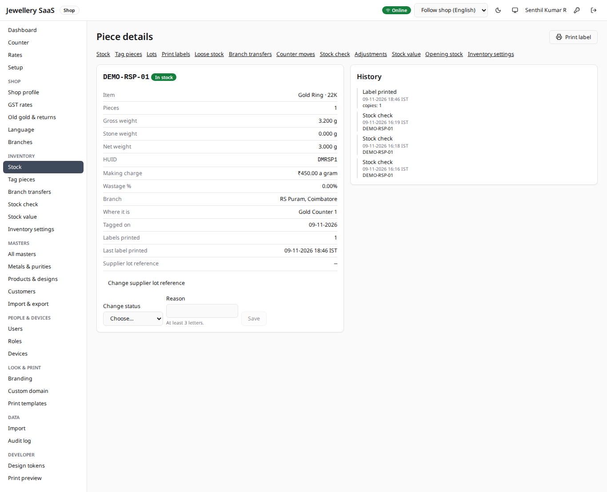
    *Piece details for DEMO-RSP-01, a 22K Gold Ring at Gold Counter 1: making charge ₹450.00 a gram, Labels printed 1, Last label printed 09-11-2026 18:46 IST. History lists the label print and three stock checks.*

6. If the list is long, press **Show more** at the bottom.

### Which pieces show up

When you open the page, **Status** is set to **In stock**, so you see only the pieces sitting in stock right now. You can pick:

- **Active (not sold or written off)**: everything still in your shop or on its way: in stock, kept aside, out on approval, in repair, sent for melting and on the way.
- **Any status (incl. sold, written off)**: every piece ever tagged.
- One status, such as **Sold** or **Written off**.

> [!NOTE]
> **Sold**, **Melted**, **Returned to supplier** and **Written off** pieces are hidden unless you pick that status or **Any status (incl. sold, written off)**. If you can't find a piece you sold, change the **Status** box.

> [!TIP]
> On **Piece details**, **Change status** lets you mark a piece **Kept aside**, **In repair** or **Sent for melting**, and back to **In stock**. Pick the new status, write a **Reason** (at least 3 letters) and press **Save**. Other statuses change by themselves through sales and transfers.

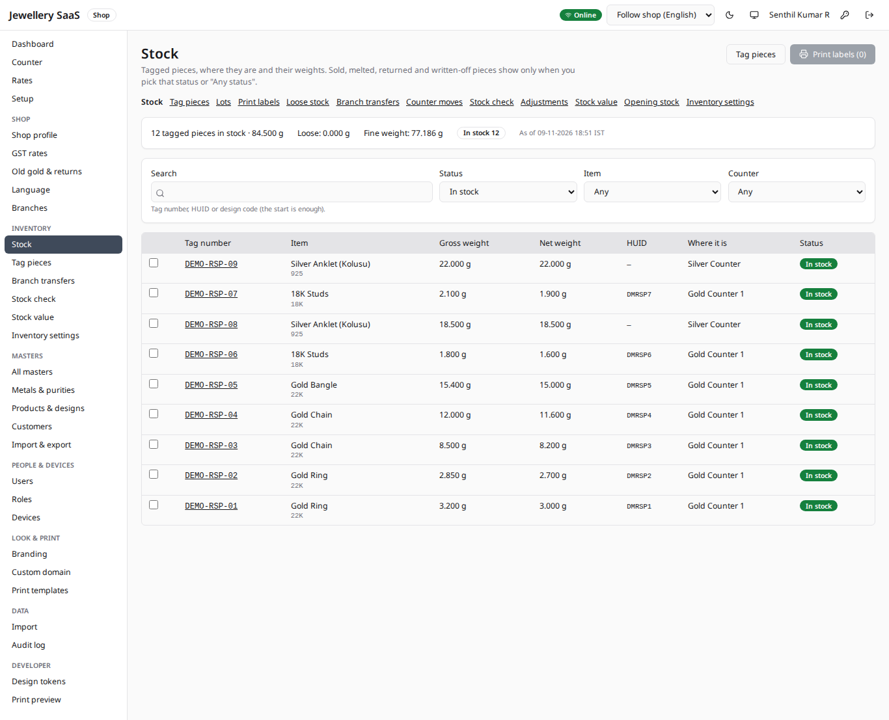
*The Stock list with Status set to In stock (the default): nine pieces, DEMO-RSP-01 to DEMO-RSP-09, at RS Puram.*

> [!NOTE]
> **Why does the top say 12 when the list shows 9?** The list has one row per **tag**. The count at the top adds up the **Pieces** on each tag. One tag can hold more than one piece, for example a pair of studs tagged together counts as 2. Here the 9 tags hold 12 pieces, and the weight (84.500 g) is the same either way.

## 2. Tagging and labels (`/inventory/tag`, `/inventory/labels`)

**What this is:** tagging gives each new piece its own tag number and records its weights. The label puts that number on the piece so anyone can scan it.

### Tag one piece

1. Go to **Inventory > Tag pieces**. Choose **One piece** (or **Many pieces** for up to 200 rows at once).

    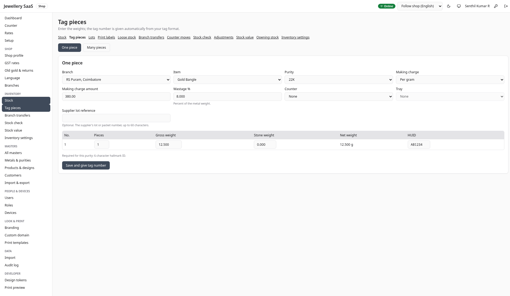
    *The One piece form filled in: RS Puram, Gold Bangle, 22K, Per gram making charge, 12.500 g gross, HUID.*

2. Choose the **Branch**, **Item** and **Purity**.
3. Fill in **Gross weight**, **Stone weight** (if any) and **Pieces**. The app works out the **Net weight**.
4. If the purity needs it, type the **HUID** (6 letters or digits).
5. Optional: **Making charge** type and **Making charge amount**, **Wastage %**, **Counter**, **Tray** and **Supplier lot reference**.
6. Press **Save and give tag number**. The app shows "1 pieces tagged:" with the new tag number.

> [!WARNING]
> You never type the tag number yourself. The app gives it from your tag format (set in **Inventory settings**). Changing the format only affects new pieces.

### Print labels

1. Pick the pieces. You can do this in three ways:
   - After tagging, press **Print their labels**.
   - On **Stock**, tick the boxes beside the pieces and press **Print labels (2)** (the number is how many you ticked).
   - Open **Print labels**, scan or type the tag number under **Add a piece by tag number** and press **Add**.

    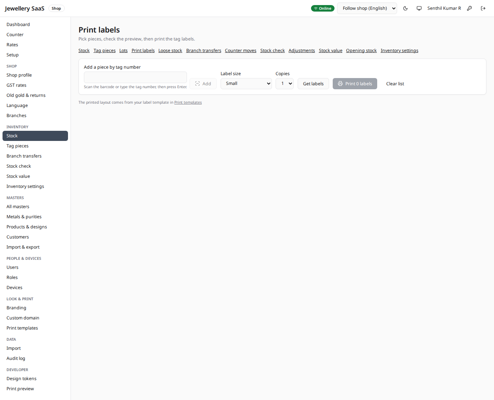
    *Print labels with two pieces picked from Stock. Label size, Copies, Get labels and Clear list are at the top; the pieces appear once you press Get labels.*

2. Choose the **Label size**: **Small**, **Medium** or **Barbell (loop) tag**, and the number of **Copies**.
3. Press **Get labels**. A preview of each label appears below: tag number, barcode, item and purity, **GW** and **NW**, and the HUID. Press **×** on a label to take that piece off the list, or **Clear list** to start again.

    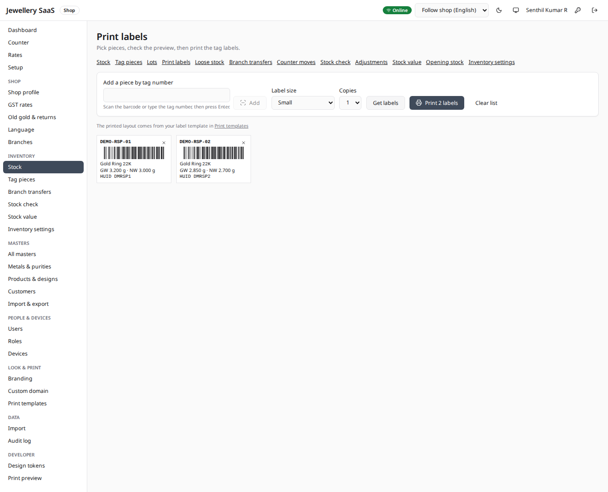
    *Two Small labels for DEMO-RSP-01 and DEMO-RSP-02 (Gold Ring 22K), each with a barcode, GW, NW and HUID. The button now says Print 2 labels.*

4. Press **Print 2 labels** (the number matches your labels × copies) and print from your browser.

> [!TIP]
> Until you press **Get labels**, the page doesn't list the picked pieces yet; it just shows **Clear list**. That's normal. Press **Get labels** to see them.

> [!NOTE]
> Pressing **Get labels** counts as a print, and the piece's **Labels printed** count goes up. If a piece was printed before, you see "These labels were printed before. Tick reprint and give a reason." Tick **Reprint** and fill in **Reason for reprint**.

## 3. Transfers between branches (`/inventory/transfers`)

**What this is:** sending pieces from one branch to another, for example from RS Puram to Gandhipuram. The app keeps track until the other branch says the pieces arrived.

### Send pieces

1. Go to **Inventory > Branch transfers** and open the **Send** tab.

    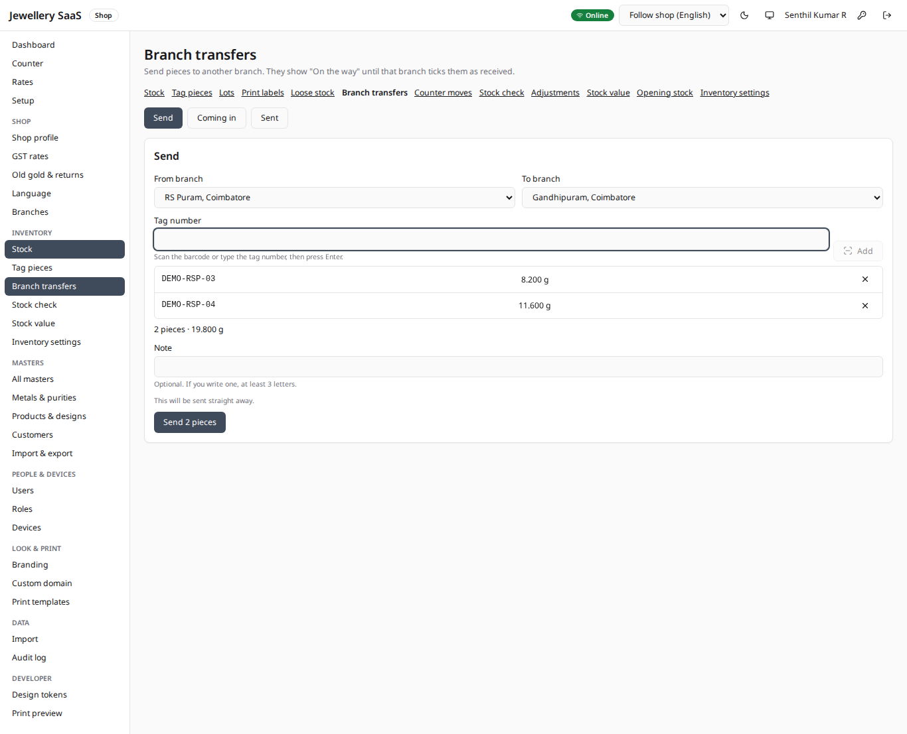
    *The Send tab: RS Puram to Gandhipuram with two chains, DEMO-RSP-03 and DEMO-RSP-04 (2 pieces · 19.800 g), ready to send. It is not sent yet.*

2. Choose **From branch** and **To branch**.
3. Scan or type each **Tag number** and press Enter (or **Add**). Only pieces **In stock** can be added. Each piece shows with its weight; press **×** to take one off. Below the list you see the total, for example "2 pieces · 19.800 g".
4. Optional: write a **Note** (at least 3 letters if you write one).
5. Press **Send 2 pieces** (the number matches your list).
   - If you can approve transfers (usually owner or manager), you see "This will be sent straight away." and get "Sent. Transfer number {no}."
   - If not, it is "Saved as a draft. It waits for approval before it can be sent." A manager then presses **Approve** and **Send now** on the **Sent** tab.
6. The pieces now show **On the way**.

### Receive pieces

1. At the other branch, open the **Coming in** tab and press **Receive**.

    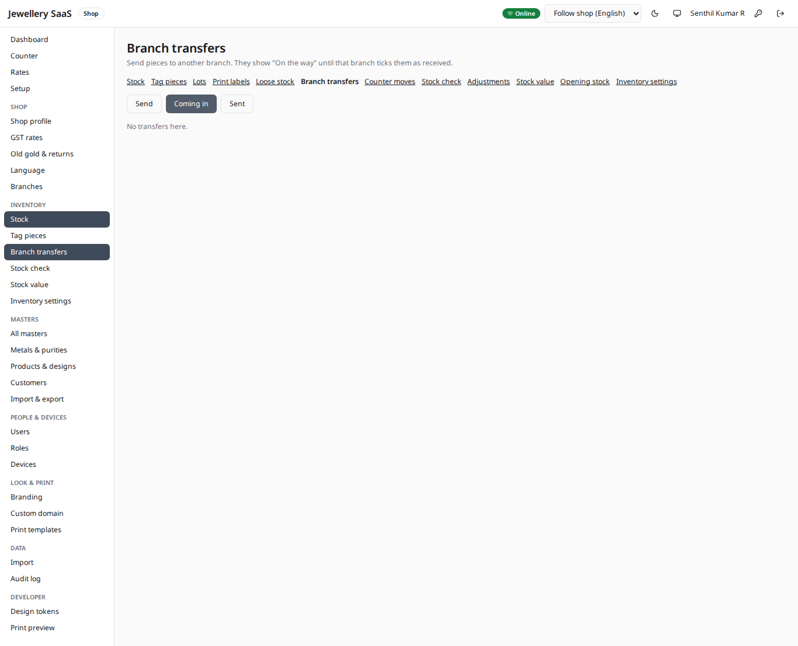
    *The Coming in tab. It shows "No transfers here." because nothing had been sent yet when this was taken.*

2. **Tick the pieces that arrived** (scanning works too).
3. Press **Confirm {n} received**. The pieces become **In stock** at this branch.

> [!WARNING]
> Pieces you don't tick are reported as missing. The app asks you to say what happened to them (at least a few letters).

> [!TIP]
> The sending branch can use **Send back** while pieces are on the way. They return to the sending branch. A reason is needed.

## 4. Stock check (`/inventory/stock-check`)

**What this is:** scanning every piece on a branch, counter or tray to find anything missing or in the wrong place. Do it regularly, for example every evening for one counter.

1. Go to **Inventory > Stock check**. Choose the **Branch**. Pick a **Counter** or **Tray**, or leave it as **All** to check the whole branch.
2. Press **Start check**.

    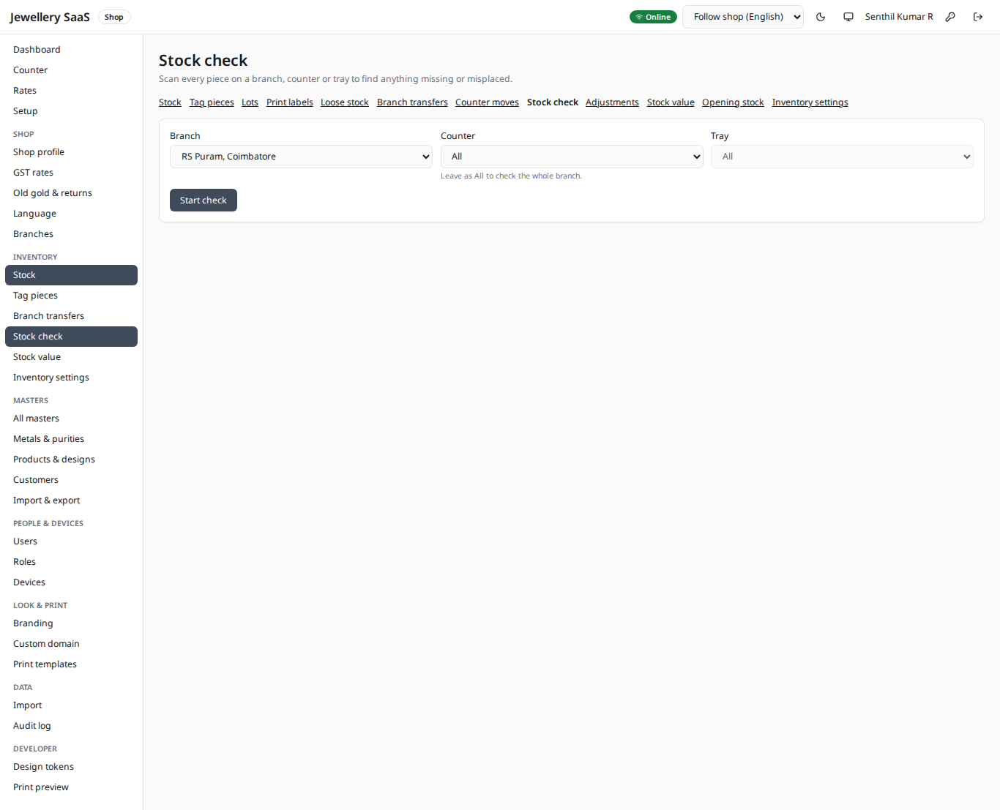
    *Stock check: choose Branch, Counter and Tray (All checks the whole branch), then Start check.*

3. Scan every piece into the **Tag number** box (or type it and press **Add**). The last scan shows under the box, for example "DEMO-RSP-02 · Found", and the progress line shows, for example, "2 of 9 found · 0 extra".
4. On the left, **Scanned** lists what you have scanned. On the right are three tabs, each with a count:
   - **Found**: scanned and in the right place.
   - **Not scanned yet**: expected here but not scanned.
   - **Not expected here**: scanned but it belongs elsewhere, with a reason such as **Belongs to another counter or tray** or **Belongs to another branch**.
5. Scanned a piece by mistake? Press the small undo arrow beside it in the **Scanned** list (**Undo scan**).

    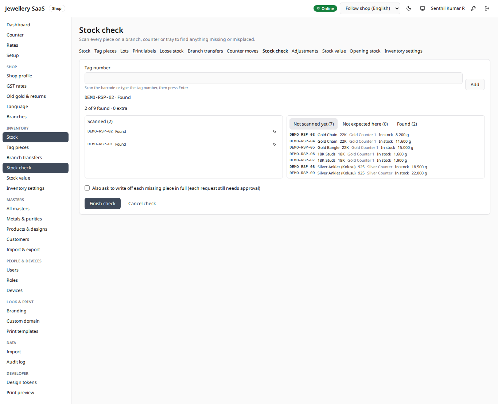
    *A check at RS Puram: 2 of 9 found. The Not scanned yet (7) tab lists the other seven pieces with their counter and weight. Finish check and Cancel check are at the bottom.*

6. When done, a manager presses **Finish check** (or **Cancel check** to throw the check away). Staff see "A manager will finish this check."
7. Read the **Check report**.

> [!TIP]
> "Search for missing pieces first. If they are really gone, record them under Adjustments." Before pressing **Finish check**, you can tick **Also ask to write off each missing piece in full (each request still needs approval)**.

## 5. Adjustments and approvals (`/inventory/adjustments`)

**What this is:** the way to fix stock when real life doesn't match the app, for example a piece lost weight in polishing, or a piece is lost. Every request waits for approval before stock changes.

### Kinds of adjustment (**What happened**)

| On screen | Use it when |
|---|---|
| **Weight loss** / **Weight gain** | A piece weighs less or more than recorded |
| **Pieces lost** / **Pieces found** | The count of pieces is wrong (for example in loose stock) |
| **Write off part** | Part of the stock is gone or damaged |
| **Write off whole piece** | The whole tagged piece leaves stock for good |
| **Correction** | Fixing an earlier typing mistake |

**Reason type** choices: **Polishing**, **Repair**, **Melting loss**, **Breakage**, **Loss**, **Weighing mistake**, **Counting mistake**, **Other**.

### Ask for an adjustment

1. Go to **Inventory > Adjustments** and press **New adjustment**.

    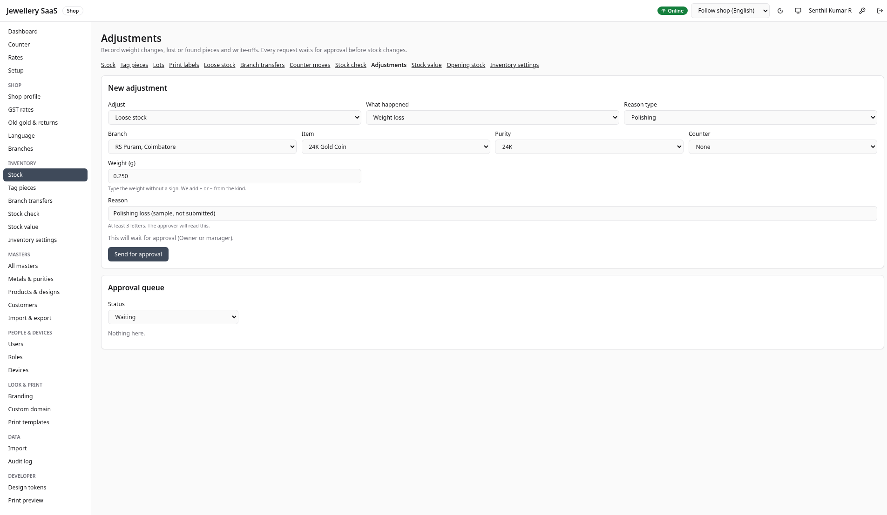
    *A New adjustment for Loose stock: Weight loss, Polishing, 0.250 g of 24K Gold Coin at RS Puram, with a reason. For a tagged piece you scan its tag instead.*

2. Under **Adjust**, choose **A tagged piece** (scan its tag) or **Loose stock**.
3. Choose **What happened** and the **Reason type**.
4. Type the weight in **Weight (g)** without a sign. The app adds + or − from the kind.
5. Write a **Reason** (at least 3 letters). The approver will read it.
6. Press **Send for approval**. The request shows **Waiting**.

### Approve or reject

1. Open the **Approval queue**.

    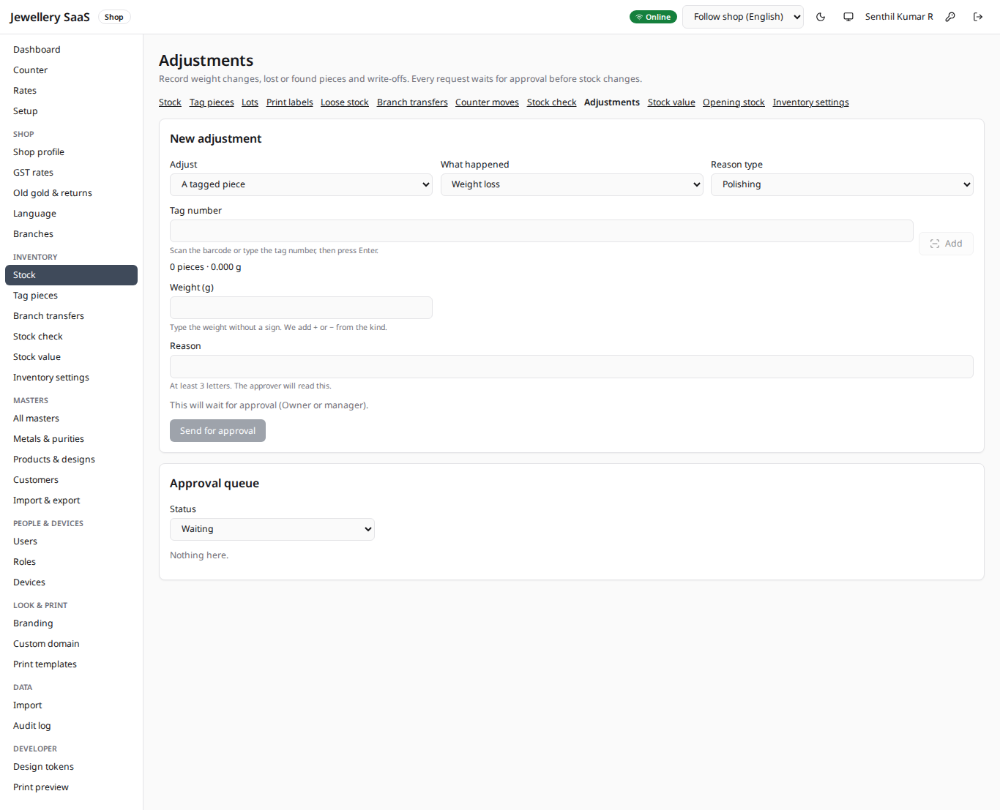
    *The Approval queue under the form, with Status set to Waiting. It says "Nothing here." because no request was waiting when this was taken.*

2. Read the request and press **Approve** or **Reject**. To reject, you must write a **Note (needed to reject)**.
3. The person who asked can press **Withdraw request** while it is still waiting.

### Who can approve

This is set in **Inventory settings > Who approves**:

- **Owner or manager** (the usual setting): the owner or a manager of that branch can approve.
- **Owner only**: only the owner can approve.

> [!WARNING]
> **Approving your own request:**
> - **Owner:** can approve their own request. It is then marked **Approved by the person who asked**, so everyone can see it.
> - **Manager:** can never approve their own request. They see "A manager cannot approve their own request. Ask the owner." The owner must approve it.

> [!NOTE]
> A **Written off** piece can never change again. Writing off a whole piece needs a tagged piece.

## 6. Valuation (`/inventory/valuation`)

**What this is:** what your stock on hand is worth at today's selling rate. Useful for insurance, the bank, or just knowing.

1. Go to **Inventory > Stock value**.

    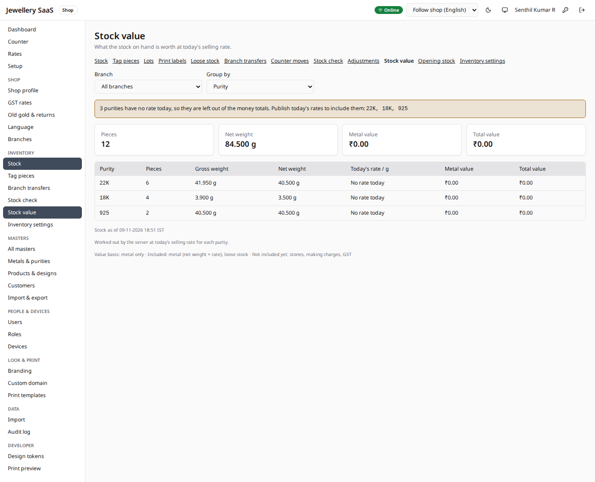
    *Stock value for All branches by Purity: 12 pieces, 84.500 g net (22K 6, 18K 4, 925 2). Every amount is ₹0.00 and each row says No rate today, because today's rates were not published. The yellow banner says so.*

2. Choose the **Branch** (or all) and **Group by**: **Purity**, **Metal**, **Branch**, **Counter** or **Item**.
3. Read **Metal value** and **Total value**. Each row shows **Today's rate / g**.

> [!NOTE]
> For now the value is **metal only**. The line under the total reads: "Value basis: metal only · Included: metal (net weight × rate), loose stock · Not included yet: stones, making charges, GST". So loose stock **is** counted, but stones, making charges and GST are not added yet.

> [!WARNING]
> **Stock value shows ₹0.00 until today's rates are published.** The pieces and weights still show, but every money amount stays at ₹0.00 for any purity marked **No rate today**. A yellow banner lists those purities, for example "3 purities have no rate today, so they are left out of the money totals. Publish today's rates to include them: 22K, 18K, 925". Publish today's rates first (see the onboarding guide, section 7), then open **Stock value** again. A ₹0.00 total does **not** mean your stock is gone.

---

## Also in Inventory

- **Lots** (`/inventory/lots`): stock that came in by weight from a supplier, waiting to be tagged. Shows how much is tagged and what is left.
- **Loose stock** (`/inventory/loose`): stock kept by weight without tags.
- **Counter moves** (`/inventory/moves`): move pieces to another counter or tray in the same branch.
- **Opening stock** (`/inventory/opening`): bring in the stock you already have from a spreadsheet. Nothing is saved until you apply.
- **Ageing** (`/inventory/ageing`): how long pieces have been in stock. Switch it on in Inventory settings.
- **Inventory settings** (`/settings/inventory`): tag number format, photos, ageing bands, transfer and adjustment number formats, and **Who approves**.

---

## Worked examples

> [!NOTE]
> All numbers below are example numbers.

### Example 1: tag one ring and print its label

Priya at RS Puram gets a new 22K gold ring, like the demo ring `DEMO-RSP-01`.

1. **Tag pieces > One piece**. **Branch**: RS Puram, Coimbatore. **Item**: Gold Ring. **Purity**: 22K.
2. **Gross weight** 3.200, **Stone weight** 0.200, **Pieces** 1. The app shows **Net weight** 3.000 g.
3. **HUID**: the 6 characters stamped on the ring, for example `DMRSP1`.
4. **Counter**: Gold Counter 1. Press **Save and give tag number**. The ring gets its tag number from your tag format, here `DEMO-RSP-01`.
5. Press **Print their labels**, keep **Small** and **Copies** 1, press **Get labels**, check the preview (GW 3.200 g · NW 3.000 g, HUID DMRSP1) and press **Print 1 labels**.

### Example 2: a weight-loss adjustment that waits for approval

After polishing, ring `DEMO-RSP-01` weighs 3.150 g instead of 3.200 g.

1. Jai (staff) opens **Adjustments > New adjustment**. **Adjust**: **A tagged piece**, scans `DEMO-RSP-01`.
2. **What happened**: **Weight loss**. **Reason type**: **Polishing**. **Weight (g)**: 0.050.
3. **Reason**: "Lost weight in polishing, checked on scale." Press **Send for approval**. It shows **Waiting**.
4. The manager opens **Approval queue** and presses **Approve**. The ring now shows gross 3.150 g, and its **History** shows **Adjusted**.

If the manager had asked for this herself, the owner would have to approve it.

### Example 3: a stock check finds a missing piece, then a write-off request

1. At closing, the manager checks the whole RS Puram branch: **Stock check**, **Branch** RS Puram, Coimbatore, **Counter** **All**, **Start check**.
2. 9 pieces are expected. After scanning everything on the counters: "8 of 9 found · 0 extra". The **Not scanned yet (1)** tab shows `DEMO-RSP-09` (Silver Anklet (Kolusu), Silver Counter).
3. Staff search the shop and the repair box. It isn't found.
4. The manager presses **Finish check** and ticks **Also ask to write off each missing piece in full (each request still needs approval)**. The app says "1 write-off requests were created. They wait in Adjustments for approval."
5. The owner opens **Adjustments > Approval queue**, reads the request (**Write off whole piece**) and presses **Approve**. `DEMO-RSP-09` now shows **Written off** and is hidden from the normal Stock list.

---

## FAQ

**I can't find a piece I sold.** Change **Status** on the Stock list to **Sold** or **Any status (incl. sold, written off)**.

**Can I choose my own tag numbers?** No. The app gives them from the tag format in **Inventory settings**.

**Why does it say "These labels were printed before"?** The piece already had a label. Tick **Reprint** and give a reason, so you know why extra labels exist.

**My transfer says "Draft". Why?** You can't approve transfers yourself, so a manager must press **Approve** and then **Send now**.

**A piece didn't arrive with the transfer.** Don't tick it when receiving. Say what happened in the note. It is reported as missing.

**Why can't my manager approve her adjustment?** Nobody but the owner may approve their own request. Ask the owner.

**Can a written-off piece come back?** No. Written off is final. Check carefully before approving.

**Why does Stock value show ₹0.00?** Today's rates haven't been published. Each purity says **No rate today**. Publish today's rates and open the page again.

**The Stock page says 12 pieces but I see only 9 rows. Why?** Some tags hold more than one piece, such as a pair of studs. The list shows one row per tag; the count at the top adds up the pieces.

**I see "This part of Inventory isn't switched on for your shop yet."** That screen isn't turned on for your shop. Ask your reseller or our team.
