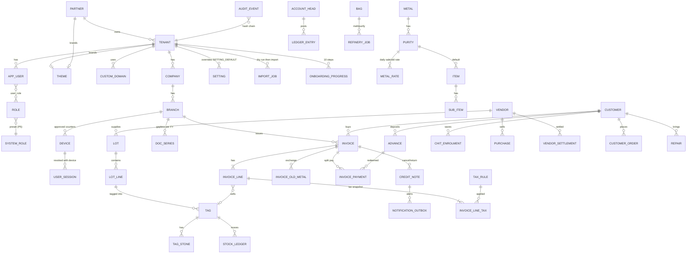

# Jewellery Retail SaaS — Data Model (v1.9, 24 Oct 2026; Platform module frozen)

These are hand-written PostgreSQL migrations for the NestJS + Drizzle backend. PostgreSQL is the only store, and pg-boss drains the outbox.
**Design rule (Adithya, v0.2): business logic lives in the NestJS app. The DB keeps only minimal guardrails:** gapless counters, immutability of issued documents, an append-only hash-chained audit, RLS, constraints, and per-module grants.
Tested on **PostgreSQL 17.11** (VPS test DB), both paths: `MODE=fresh` → **`SUMMARY: 323 passed, 0 failed — 2026-10-24 10:59 IST`**, `MODE=upgrade` (dev applied state → 910–970) → **`SUMMARY: 324 passed, 0 failed — 2026-10-24 10:59 IST`**; schema dumps identical (see `tests/last_run.log`).

```
migrations/  000_bootstrap (superuser, once) · 010_platform · 015_branding · 020_billing · 030_notifications · 035_pgboss
             · 040_masters (incl. tax_rule, gst_config, sales_policy) · 045_platform_defaults (seeded defaults) · 050_rates · 060_hr · 070_accounts · 080_inventory · 090_approvals · 100_sales
             · 110_orders · 120_purchases · 130_refinery · 140_reports (views) · 900_security (RLS + grants)
             ── applied on dev 2026-10-24 09:54 IST: 010–900 (19 files, checksums in migrations/APPLIED.sha256) — IMMUTABLE ──
             · 910_platform_v14_v18 · 920_platform_functions_v15 · 930_masters_v15_v18 · 940_hr_v17
             · 950_platform_language · 960_security_v18 (re-run of the security layer)
             · 970_import_mapping_snapshot
apply.sh     create DB + apply all (dev); APPLY_SET=applied | new for the upgrade path
tests/       seed.sql · issue_invoice_uow.sql (reference unit-of-work the sales module runs) · run_tests.sql (app_rw)
             · run_owner_tests.sql (owner bypass attempts) · run_worker_tests.sql (app_worker) · run_all.sh (+ app_admin, app_ro checks) (+30-way concurrency) · last_run.log
```

## Migration immutability rule (since v1.9)
- A migration recorded in `migrator.schema_migrations` on dev is **never edited**. The backend runner (`packages/db/src/migrate.ts`)
  stores sha256 of the file bytes and refuses to run if an applied file changed. `migrations/APPLIED.sha256` lists the applied
  files (000 + 26 recorded: 010–900 and 910–970, dev migrate 2026-10-24 11:09 IST) and their checksums; `tests/run_all.sh` fails (`applied migrations unchanged`) if any of them differs.
- Every change is a **new file whose name sorts after the last existing file** (plain filename sort; `000_bootstrap` is a separate
  superuser step and is never recorded). The next free numbers are **980–999** (note `1000_…` would sort *before* `960_…`).
- After a successful dev migrate, append the new files' lines to `APPLIED.sha256` (Wheeljack sends the `schema_migrations` export).
- RLS/grants for new tables: the security layer is re-runnable, so a change that adds tables ends with a new security file that
  re-applies the loops (as `960_security_v18.sql` does), or with targeted policies/grants.
- Both paths are tested on the VPS test DB: `MODE=fresh` (all files from zero) and `MODE=upgrade` (the applied files, a state
  check, then the new files); `tests/run_all.sh` saves `/tmp/dm_schema_<mode>.sql` (pg_dump --schema-only) for comparison.

## v1.9 — re-expressing v1.4–v1.8 as new migrations; platform.language
- 010/025/040/060/900 were restored byte for byte from the image that ran the dev migrate (all 19 match `schema_migrations`).
  The pre-restore v1.8 copies are in `_v18_backup/` (reference only, not applied).
- `910`: generic `bump_version` (TG_ARGV column, INSERT resets to 1), `aa_version` triggers re-created BEFORE INSERT OR UPDATE,
  `print_template.row_version` (the applied 025 bumped the document `version` — fixed), drops `company.bank_accounts` and
  `app_user.failed_logins/locked_until`, `import_job.mapping_profile_id` + same-kind FK, `platform.rate_limit_bucket`.
- `920`: `resolve_partner`; `provision_tenant` 14 → 15 args (`p_deployment_mode`, internal `tenant.provisioned` audit).
- `930`: customer `pan_key_id` + PAN/Aadhaar checks; `vendor.bank_accounts` dropped; `masters.bank_account`.
- `940`: `hr.staff` `pan_key_id`, `pan_last4`, checks. These columns are **not in 060_hr.sql** (applied, immutable). 940 appends them at the end of the table (columns 15–16, after `left_on`), so introspection from 060 alone or a Drizzle pull taken before the 940 migrate won't show them.
- `950`: `platform.language(code PK, name, native_name)` = en, ta, hi, te, kn, ml; FKs from `tenant.default_language`,
  `app_user.language`, `branding.print_template.print_language`, `notifications.template.locale`. Read-only for all app roles.
- `960`: the v1.8 security script re-run (policies on the new tables, v1.4–v1.7 grant blocks) + `platform.language` grants.
- The schema from the new files equals the v1.8 schema except constraint names (`customer_pan_all_or_none` /
  `customer_pan_ciphertext`, same for staff, instead of auto names), one column comment, and the language table/FKs.

## 970 import mapping snapshot
- `platform.import_job.mapping_snapshot jsonb` (JSON object): the resolved column mapping the import used.
- Set once: on INSERT, or by the first UPDATE from NULL while status is `uploaded` / `validating` / `validated`. After that,
  any change (including back to NULL) is rejected by trigger `import_job_snapshot_guard`.
- Commit = a real import (`dry_run = false`) moving to `importing` or `completed`: requires a non-null snapshot and the
  `dry_run_of` job in status `validated`. (A dry run reaching importing/completed is still rejected by the old CHECK.)
- Grants: none added — app_rw's existing table-level UPDATE on `import_job` covers the column. Tests I1–I8.

## 971 provision_tenant bill series prefix
- New signature (the 15-arg one is dropped, so there is exactly one function and no overload ambiguity):
  `platform.provision_tenant(p_slug, p_display_name, p_partner_id, p_legal_name, p_gstin, p_pan, p_state_code,
  p_branch_code, p_branch_name, p_owner_name, p_owner_phone, p_owner_username, p_owner_password_hash,
  p_language DEFAULT 'en', p_deployment_mode DEFAULT 'shared', p_bill_series_prefix text DEFAULT NULL) RETURNS uuid`.
- Existing 13–15 positional-arg calls keep working. If you add the prefix, pass it as the 16th arg or as `p_bill_series_prefix => ...`.
- NULL or blank means `upper(p_branch_code)` (the old behaviour). The value is upper-cased, then it must match the branch
  CHECK `^[A-Z0-9][A-Z0-9/-]{0,11}$`. That is 1–12 chars of A–Z, 0–9, `/` and `-`, and it can't start with `/` or `-`.
  An invalid prefix raises SQLSTATE 23514 (check_violation) before anything is written.
- Unchanged: SECURITY DEFINER, `search_path = pg_catalog, pg_temp`, owner tenant_provisioner, EXECUTE revoked from PUBLIC
  and granted to app_admin only. The `tenant.provisioned` audit event now includes `bill_series_prefix`. Tests BP1–BP9.

## 972 masters.metal / masters.purity version + is_active
- Both tables gain `version int NOT NULL DEFAULT 1` and `is_active boolean NOT NULL DEFAULT true`. Existing rows read 1 / true.
- They also get the standard `aa_version` trigger (`platform.bump_version()`, BEFORE INSERT OR UPDATE). INSERT forces version 1,
  every UPDATE adds 1, and setting `version` yourself is rejected. Use `UPDATE … WHERE id = $1 AND version = $2` for optimistic locking.
- `is_active = false` is a soft-disable. Hide inactive metals/purities from pickers. FKs from rates/inventory still accept them,
  so blocking new use of an inactive row is an app rule.
- No grants added; the existing table-level grants cover the columns. Seeds (`tests/seed.sql`, `seeds/dev_demo_5_shops.sql`)
  list columns explicitly, so they need no change. Tests MV1–MV10 (MV1/MV2 only in upgrade mode).

## 973 platform.idempotency_key (generic API Idempotency-Key store)
- Columns:
  - `tenant_id` (FK tenant)
  - `scope`: method + /v1 route template, e.g. `POST /v1/settings/gst-config/{id}/replace`. CHECK 1–200 chars matching
    `^(POST|PUT|PATCH|DELETE) /v1/\S*$`.
  - `key`: CHECK 1–255 chars.
  - `request_hash`: 1–128 chars.
  - `response_status`: smallint 100–599.
  - `response_body`: jsonb.
  - `created_at`.
  - `expires_at`: default now() + 24 h, CHECK `expires_at > created_at`.
- Keys: PK `(tenant_id, scope, key)` and index `idempotency_key_expires_idx (expires_at)`.
- App flow:
  - Insert the row in the same transaction as the side effect.
  - On 23505 `idempotency_key_pkey`, re-read the row and replay `response_status`/`response_body`, or return 422 if
    `request_hash` differs.
  - A concurrent duplicate blocks until the first transaction commits, then gets 23505 (IK25). If the first transaction
    rolls back, the second insert succeeds.
  - No pending state and no user_id.
- RLS: ENABLE + FORCE, `tenant_isolation`, restrictive `no_partner_access`, and `worker_purge_read` / `worker_purge`
  (app_worker, `expires_at < now()`). These are created explicitly in 973 because the 960 loops ran before the table existed.
- Grants:
  - app_rw: SELECT, INSERT, DELETE; no UPDATE. DELETE is limited by the restrictive `rw_delete_expired_only` policy
    (`expires_at <= now()`) together with `tenant_isolation`, so app_rw can delete only its own tenant's expired rows.
    Reusing an expired key: `DELETE … WHERE scope=$1 AND key=$2 AND expires_at <= now()`, then INSERT, in one transaction.
    Deleting a live row or another tenant's row affects 0 rows; it does not raise an error.
  - app_worker: SELECT, DELETE for the purge job: `DELETE FROM platform.idempotency_key` deletes only expired rows.
  - app_ro and app_admin: none. Stored responses may hold customer data, so it is treated like `rate_limit_bucket`.
  - Writer roles: none, so insert it as app_rw, outside `SET ROLE`.
  - No DB functions.
- Who else can DELETE (checked on the test DB; all are the owner/admin chain, by design):
  - `app_migrator`: table owner, still subject to FORCE RLS (`tenant_isolation`); migrations only.
  - The test cluster superuser `jw_test` (superuser, bypasses RLS). On dev this is the postgres superuser.
  - The predefined `pg_write_all_data`, which has no members. IK26 fails if anyone is added to it.
  - No app role (app_ro, writers, app_admin, platform_lookup) has DELETE.
- Tests IK1–IK31. The worker purge is unchanged (`expires_at < now()`); app_rw uses `<=`.

## 974 platform.file (object-storage file metadata) + import_job.file_id
- Columns:
  - `tenant_id` (FK tenant).
  - `id`: default `platform.uuid_v7()`.
  - `area`: one of imports / exports / attachments.
  - `object_key`: UNIQUE `file_object_key_uq`, global across tenants.
  - `original_name`: 1–255 chars.
  - `content_type`.
  - `size_bytes`: >= 0.
  - `sha256`: raw 32-byte digest in bytea, the same convention as `code_hash` / `token_hash`.
  - `created_by`: nullable, composite FK `(tenant_id, created_by)` → app_user.
  - `created_at`.
  - `deleted_at`: soft delete. Primary key `(tenant_id, id)`.
- RLS: ENABLE + FORCE, `tenant_isolation`, restrictive `no_partner_access`. Created explicitly because the 960 loops
  predate the table.
- Grants:
  - app_rw: SELECT, INSERT, `UPDATE (deleted_at)`; no DELETE. Soft delete is `UPDATE … SET deleted_at = now()`.
  - app_ro: SELECT, following the convention that reports read every non-secret table.
  - app_worker: none, since no job needs files yet. A future cleanup job that removes soft-deleted objects will need
    SELECT (and maybe DELETE) in a new migration.
  - Effective DELETE is held only by the owner chain: app_migrator, superusers, and member-less `pg_write_all_data` (F15).
- `platform.import_job.file_id uuid NULL` with FK `import_job_file_fk (tenant_id, file_id) → platform.file(tenant_id, id)`,
  so a link can't cross tenants, plus partial index `import_job_file_idx`. The legacy `file_key text NOT NULL` stays; the app
  should keep it equal to `file.object_key` until a later migration drops it.
- Upgrade baseline is now 000–973. Tests F1–F25.

## 975 — PARKED (2026-10-27)
- `975_platform_referenced_object_keys.sql` (a cleanup-job lookup function plus the `object_key_lookup` owner role) is parked
  in `migrations/parked/`, because Adithya decided to skip file cleanup. It is not applied anywhere, not in APPLIED.sha256,
  and its tests are removed. See `migrations/parked/README.txt`.
- No tool reads that subdirectory: apply.sh, run_all.sh and migrate.ts look only at top-level `*.sql`.
- The head is 974, and upgrade mode starts from the 000–974 baseline. The next migration may reuse 975 or take a new number.
- An `object_key_lookup` role left on a test cluster from earlier runs is harmless: no object or test depends on it.

## v1.1 changes (authoritative)
- **(a) app_ro reads everything.** It has SELECT on all tables in every module schema, plus `ALTER DEFAULT PRIVILEGES` so tables added by future migrations are readable too. The old log line `permission denied for table customer_group` came from the test's deliberate **INSERT** as app_ro, which correctly failed; it was never a SELECT problem. It is now reported as `PASS app_ro INSERT correctly denied`, and a new test SELECTs every table and view (100) as app_ro.
- **(b) New module roles `orders_writer`, `purchases_writer`, `refinery_writer`.** They are NOLOGIN; app_rw is a member WITH INHERIT FALSE, SET TRUE. Each writes only its own schema plus `platform.doc_counter`. None of them can write inventory, so stock changes still go only through inventory_writer. app_rw lost its direct write rights on orders, purchases and refinery.
- **(c) Schema-change guard restored.** Event triggers (`ddl_command_end`, `sql_drop`) allow DDL in the module schemas only for `app_migrator` (blocked for everyone else, superusers included) and log all migration DDL to `public.schema_change_log`. app_worker may only do DDL in `pgboss` (and its own temp schema).
  - The credit-note → outbox trigger (G7, INV-5) is also present. Both G7 and G7b are in the current migrations: `000_bootstrap.sql` (DDL guard) and `100_sales.sql` (`notifications.credit_note_alert`).
- **(d) Client-supplied invoice numbers are rejected.** This covers both an arbitrary number and the correct "next" number used without allocating it from the counter. Both are tested.
- **(e) HUID** is `varchar(6) CHECK (huid ~ '^[A-Z0-9]{6}$')` on tags and invoice lines. Decision: **no silent normalisation in the DB.** The app upper-cases input, and the DB rejects lowercase, short or non-alphanumeric values (tested).
- **(f) Only tax invoices and credit notes are gapless.** `sales.doc_series` now accepts only `tax_invoice` and `credit_note`. Everything else (estimates, receipts, orders, repairs, purchases, vouchers, transfers, memos, refinery jobs) uses `platform.doc_counter`, which has no guards and allows gaps, or ordinary sequences. The gap report covers only the two statutory series.
- **pg-boss.** `035_pgboss.sql` creates schema `pgboss` owned by `app_worker` (a LOGIN role), and pg-boss creates its own tables there. On `notifications.outbox` the worker gets SELECT plus UPDATE on the delivery columns only (`status, attempts, available_at, claimed_at, claimed_by, sent_at, last_error`). Cross-tenant RLS policies (`worker_read`, `worker_update`) let one shared worker drain all tenants with `FOR UPDATE SKIP LOCKED`. The worker cannot insert or delete outbox rows, edit payload or topic, or read or modify sales and inventory (tested).

## Module → schema → write ownership

| Module | Schema | Who may write | How it is enforced |
|---|---|---|---|
| Platform | `platform` | app_rw: users, role assignments, tenant settings, branches, devices, sessions, OTP, imports, onboarding. Global catalogues (permission, system_role, setting_default, onboarding_step) are read-only. Audit rows only via the audit trigger (platform_writer). Admin console (`app_admin`): tenants, partners, billing | grants + RLS |
| Branding | `branding` | app_rw, limited to its own scope level | scope CHECKs + RLS |
| SaaS billing | `billing` | app_rw / control plane | grants |
| Notifications | `notifications` | app_rw / sales_writer INSERT into the outbox (cancellation alerts via the G7 trigger); app_worker SELECT and UPDATE of delivery columns only, cross-tenant | column grants + worker RLS |
| Masters (incl. GST config) | `masters` | app_rw CRUD. Platform tax rules only by platform_writer members | grants + RLS |
| Rates | `rates` | app_rw INSERT only (a correction is a new row) | no UPDATE/DELETE grant |
| HR | `hr` | app_rw | grants |
| Accounts | `accounts` | `ledger_entry`: **accounts_writer** INSERT only | grants |
| Inventory | `inventory` | app_rw: lots, tags (descriptive columns), stones, transfers. **`stock_ledger` INSERT and `tag.status/branch_id`: inventory_writer only** | table and column grants |
| Approvals | `approvals` | app_rw; sales_writer marks requests consumed | grants + maker≠checker CHECK |
| Sales | `sales` | **invoice / lines / line taxes / old metal / payments / credit notes / doc_series: sales_writer only.** app_rw: estimates, advances, chit | grants + guard triggers |
| Orders, Purchases, Refinery | own schemas | **orders_writer / purchases_writer / refinery_writer** (via SET LOCAL ROLE); no stock writes | grants |
| Reports | `reports` | **nobody**; views only (`security_invoker`, so caller RLS applies). app_ro is SELECT-only | no tables |

**Roles:**
- `app_migrator` owns all objects. It is not a superuser and has no BYPASSRLS.
- `app_rw` is the API role. `app_ro` is for reports. `app_worker` is pg-boss. `app_admin` is the platform admin console (P23). It can see tenants, partners, billing and usage, but has no grant on any shop table.
- The module roles (`sales_writer`, `inventory_writer`, `accounts_writer`) are NOLOGIN. `app_rw` is a member **WITH INHERIT FALSE, SET TRUE**: it has none of their rights by default, and the NestJS module's unit of work runs `SET LOCAL ROLE sales_writer` (later `SET LOCAL ROLE inventory_writer` for the stock step) inside the request transaction.
- This keeps any other module's code, which runs as plain app_rw, from writing invoices or stock, and keeps the whole sale atomic in one transaction. It does **not** protect against a fully compromised API process. That is what the immutability triggers and the audit chain are for.

## Guardrails that remain (and why each)

| # | Guardrail | Why it is in the DB rather than only the app |
|---|---|---|
| G1 | `sales.doc_series` locked counter + trigger: next_no may only go **+1**, starts at 1, no rewind or skip | INV-1. Postgres SEQUENCEs leave gaps; a counter row lock serialises issuers and rolls back with the transaction. The trigger stops any code path (or the owner) from rewinding or skipping. |
| G2 | **Deferred constraint trigger**: a tax-invoice or credit-note number allocated in a transaction must be used by a document before COMMIT | Makes a gap impossible even if app code allocates and then forgets to insert. Runs SECURITY DEFINER because it fires at COMMIT under whichever role is active then. |
| G3 | Insert guard on `invoice` / `credit_note`: only sales_writer; `doc_seq` must equal the number just allocated; `fy` must match `doc_date`; `issued_at` forced to now() | INV-1/INV-2. No client-chosen or "manual" numbers, and no second series. |
| G3 | Update guard: issued documents are immutable. The only allowed change is `issued → cancelled`, and only if `cancel_credit_note_id` points at a **cancellation credit note for that invoice**. The IRN can be stamped once. Un-cancel is not allowed, and a cancelled invoice is fully frozen (N10, tested column by column). A credit note's `balance_available` can only decrease. Column grants add a second layer. | INV-4. Cancellation only via a credit note; the bill never changes. |
| G4 | Child rows (lines, line taxes, old metal, payments, credit-note lines) can only be inserted by sales_writer **in the transaction that issued the parent**, and never updated | Stops lines being added to an issued bill later. |
| G5 | `BEFORE DELETE` / `BEFORE TRUNCATE` triggers on all sales documents and counters, **for every role including the owner**. No DELETE grant for any app role. | INV-4: no deletion of bills. |
| G6 | `platform.audit_append()` + `audit_row` trigger: per-tenant gapless seq + `sha256(prev_hash ‖ canonical row)`, computed under the chain-head lock. `audit_event` blocks UPDATE/DELETE/TRUNCATE for everyone; `audit_verify()` checks the chain. | INV-3. This is the one remaining DB function with any logic, because a tamper-evident chain needs a single serialised writer that app code cannot bypass. It is attached to invoices, credit notes, counters, advances, tags, rates, transfers, purchases, settlements, approvals, users/roles/settings, gst_config and print templates. app_rw can call `audit_append` for semantic events (print, reprint, login, export). |
| G7 | **Credit-note → outbox trigger** (INV-5): every cancellation or return alert is written in the same transaction | The alert can't be skipped by app code, and the worker can't fabricate or delete alerts |
| G7b | **Schema-change guard** (event triggers + `public.schema_change_log`) | Stops anyone, including a superuser, from disabling guard triggers or dropping guarded objects outside migrations |
| G7c | **RLS ENABLED + FORCED on every table**: `tenant_id = app.tenant_id`, plus an optional restrictive `branch_scope`, plus a restrictive `no_partner_access` on every shop table: a partner session (`app.partner_id` set) sees zero shop rows even when `app.tenant_id` is also set (P3). Scope-aware policies on branding and tax rules (platform/partner/tenant). | Tenant isolation in every deployment mode. `branding.my_partner()` is a two-line RLS helper. |
| G8 | Constraints: composite FKs that include tenant_id; CHECKs (net ≤ gross, weights ≥ 0, **HUID present unless `hallmark_exempt`**, HUID format, CGST+SGST = IGST = rate, intra XOR inter tax amounts, net_payable = paid + balance, maker ≠ checker); unique HUID per tenant; unique tag in an invoice; a credit-note line once per invoice line; one active print template per type; unique hostname; GiST exclusion so effective-dated tax rules and gst_config never overlap | Cheap, declarative, and impossible to bypass. |
| G9 | Per-module grants, including column grants (`tag.status/branch_id` only for inventory_writer; app_rw has no write on stock_ledger, ledger_entry, audit or sales documents; app_ro is read-only) | Enforces "only sales writes invoices, only inventory changes stock, reports read-only". |

The remaining helpers have no logic: `uuid_v7()`, `current_tenant()` / `current_user_id()` / `current_branch()` / `current_partner()`, `fy_of(date)` (used by G3), `forbid()` and `enable_audit()`.

**Why there is no next-number function:** the app runs `INSERT … ON CONFLICT DO NOTHING` followed by `UPDATE sales.doc_series SET next_no = next_no + 1 … RETURNING next_no - 1`. That single UPDATE is atomic and takes the row lock, and G1–G3 guarantee nothing else is possible. A function would add nothing.

## Removed in v0.2 (now app-layer)
- **Sales:** `sales.issue_invoice()`, `_issue_credit_note()`, `cancel_invoice()`, `issue_sales_return()`, `next_doc_no()`, `gst_rate()`, and the estimate-numbering trigger.
- **Inventory:** `inventory.move_tag()`, `post_non_tag()`, the auto "tagged" ledger trigger, the HUID trigger (replaced by a CHECK) and the tag status trigger (replaced by column grants).
- **Rates, accounts, notifications, platform:** `rates.rate_at()`, `accounts.post()`, `notifications.enqueue()`, `platform.has_perm()`.
- **Branding:** `branding.effective_theme()`, `effective_sender()`, `resolve_host()` (replaced by an RLS read policy on verified domains) and `activate_template()`.
- **Other triggers:** the append-only triggers on rates, stock ledger and accounts ledger were removed; grants enforce append-only there instead. All tables are unchanged.
- **Not removed (still present):** the credit-note → outbox alert trigger (G7) and the schema-change/DDL guard (G7b). Earlier drafts had removed them; both were restored in v1.1 and are covered by tests.

## GST configuration design (no hard-coded rates)

**`masters.tax_rule`** has two scopes. `scope='platform'` rows are platform defaults (tenant_id NULL), maintained by platform_writer and readable by everyone. `scope='tenant'` rows are tenant overrides, governed by tenant RLS.

| Column | Meaning |
|---|---|
| `code`, `description` | e.g. GOLD_JEWELLERY, MAKING_COMPOSITE, REPAIR_SERVICE |
| `component` | metal / making / stone / hallmark / service / old_metal_purchase / other |
| `metal_code` | GOLD/SILVER/…; NULL = any (a code, so platform rows need no tenant FK) |
| `code_type`, `hsn_sac` | HSN or SAC, 4–8 digits |
| `rate`, `cgst_rate`, `sgst_rate`, `igst_rate`, `cess_rate` | CHECK: CGST + SGST = rate = IGST |
| `composite_supply`, `principal_component` | ancillary component taxed at the principal supply's rule (e.g. making with jewellery) |
| `reverse_charge` | |
| `effective_from`, `effective_to` | `[from, to)`. A GiST EXCLUDE stops overlapping rules for the same (tenant, component, metal, HSN/SAC). A rate change means closing the old rule and opening a new one. |

**`masters.gst_config`** (per tenant, optionally per company, effective-dated and non-overlapping) holds: registration type (regular/composition/unregistered), tax-inclusive pricing, rounding level (line/invoice) and round-off unit, making treatment now lives in `masters.sales_policy`, not gst_config (composite/separate), e-invoice enabled and from-date, and B2C QR.

**Snapshots on the bill:** `invoice_line` stores the principal `tax_rule_id`, `tax_rate`, `hsn_sac_applied` and `composite_supply`. `sales.invoice_line_tax` stores one row per component with the `tax_rule_id` **and** the rates and amounts as applied (taxable, rate, CGST/SGST/IGST/cess rates and amounts; intra XOR inter). Later rule edits never change an issued invoice.
Platform default rules (3% jewellery, making composite at 3%, 5% repair service) are seeded by `045_platform_defaults.sql` as tenant-overridable data, and must be confirmed with the CA.

## App-layer responsibilities (spec for NestJS services)

**TaxService:**
- Pick the rule per component for (tenant, metal_code, HSN/SAC, invoice date): a tenant rule beats the platform rule, and the rule must satisfy `daterange(effective_from, effective_to) @> date`.
- Apply `gst_config`: composite supply (ancillary components use the principal rule), rounding level and unit, tax-inclusive mode.
- Intra-state (branch state = place of supply) means CGST+SGST. Otherwise IGST. Place of supply = customer state, falling back to branch state.

**RatesService:**
- Rate in force = today's (IST) `rates.metal_rate` for (purity, kind), a branch row beating a tenant-wide row, latest `effective_from` ≤ now.
- Rates are corrected by inserting a new row.

**PricingService (per line):**
- wastage_wt = net × wastage% (3 dp).
- metal_value = (net + wastage_wt) × rate.
- MC by type: per_gram × net, percent × metal_value, flat, or per_piece × pieces, with a floor of the item's `min_mc`.
- Add the stone amount (sum of tag_stone) and the HUID charge, then subtract the discount.
- Tag guardrails: wastage below `min_wastage_pct`, or price below `min_sale_value`, needs an **approved `approvals.request`** for that tag, which is then marked consumed.

**OldGoldService:**
- net = gross − less.
- fine = net × touch%.
- Value it at the old-metal rate (see open question 3).
- If old gold exceeds the bill, the surplus becomes an old-metal purchase voucher.

**SalesService.issueInvoice:** one transaction, as in `tests/issue_invoice_uow.sql`.
- Set `app.tenant_id/user_id/branch_id`, check the permission (`sales.invoice.issue`), validate tags (in_stock, at this branch, no duplicates) and compute all amounts.
- Then `SET LOCAL ROLE sales_writer`: upsert and allocate from doc_series, insert the invoice (snapshot customer, rates and day rates), lines, line taxes, old metal and payments.
- Redeem advances, credit notes or chit (decrease balances) and insert the outbox row (e-bill).
- Then `SET LOCAL ROLE inventory_writer`: set tag status to sold and insert stock_ledger rows (sale, old_metal_in, non_tag_out). Then COMMIT.

**Statutory checks (`platform.setting_default` → tenant/branch override in `platform.setting`):**
- s.269ST cash limit (cash received ≥ ₹2 lakh is refused).
- Rule 114B: a PAN is required when the bill exceeds `sales.pan_required_above` (default 200000.00).

**SalesService.cancelInvoice / salesReturn:**
- Check the permission and require a reason (≥ 5 chars).
- Allocate from the credit-note series and insert the credit note and its lines (a line can be credited once). Return window = `masters.sales_policy.return_window_days` (default 15).
- For a cancellation, also set the invoice to `cancelled` with `cancel_credit_note_id`; G3 enforces this pairing.
- Reverse stock via inventory_writer (cancel_reversal / sales_return), restore advances, and **rely on the DB trigger G7 to write the `alert.invoice_cancelled` / `alert.sales_return` outbox row in the same transaction** (INV-5; the app must not insert it itself). A daily summary job and escalation thresholds run in pg-boss.

**InventoryService:**
- Tagging inserts the tag (HUID unless hallmark_exempt, derived from `purity.huid_required`) and, as inventory_writer, a `tagged` ledger row.
- Transfers (draft → approved → in_transit → received) and goods-on-approval move tags only through inventory_writer.

**AccountsService:** posts double-entry rows (₹ and fine grams) as accounts_writer, covering vendor settlement modes and rate-cut.

**BrandingService:**
- Resolve the theme field by field, tenant → partner → platform; merge colours, fonts and login text key by key (platform ‖ partner ‖ tenant).
- Sender config: the tenant overrides the partner per field.
- Host → tenant comes from verified `custom_domain` rows (readable before login).
- Activate a template version by deactivating the old one and activating the new one in one transaction (the unique partial index guards it).
- Cache everything per tenant.

**Authorisation:** Nest guards check the permission strings of the user's system role (`platform.system_role_permission`).

**Cancellation alerts (INV-5):** the worker reads `alerts.cancellation.alert_every` (default true) and escalates when the branch's cancellations today exceed `alerts.cancellation.escalate_per_branch_per_day` (default 5).

**INV-6:** a pg-boss job checks that `reports.series_gaps` returns 0 rows and compares against `reports.gstr1_doc_summary`.

## ER diagram (core)



## Scope: retail only (decided 20 Oct 2026)
There are no manufacturing, factory or karigar job-work tables. `orders.karigar_job` was removed, and the vendor kind `karigar` is replaced by `repair_vendor`.
- **Kept:** customer/shop orders (`orders.customer_order`, `order_line`, with an optional `vendor_id` + `vendor_due` when an order is outsourced to a supplier) and repairs (`orders.repair`, `repair_line`, with an optional `vendor_id` / `vendor_charge` for outsourced repairs).
- **Also kept:** refinery (bagging old gold and sending it to a refiner), because retail shops do this for exchanged old gold.

### Future `manufacturing` module: how it plugs in without changing existing tables
A new schema `manufacturing`, its own migration (`980_manufacturing.sql` or the next free number) and an optional `manufacturing_writer` role. All its tables carry `tenant_id` and get forced RLS automatically, because the security layer re-applies policies to every table that has `tenant_id` (add it as `980_manufacturing.sql` + a re-run security file; never renumber below the last applied file).
- `manufacturing.karigar` → FK `(tenant_id, vendor_id)` to `masters.vendor` (1:1 profile: wage basis, allowed loss %). No change to `vendor`; the app may add `'karigar'` to `vendor.kinds` through a migration that only widens that CHECK constraint.
- `manufacturing.job_card(order_line_id → orders.order_line, vendor_id → masters.vendor, purity_id → masters.purity, …)` plus `job_issue` / `job_receipt` (metal issued and received in fine grams, loss vs allowance).
- **Stock:** finished goods enter through the existing path. A received job creates an `inventory.lot` with `entry_type = 'order_receipt'` and `ref_id = job_card.id`, then tags are created as usual. Metal issued to and returned from karigars is posted to `inventory.stock_ledger` as inventory_writer, with `source_module = 'manufacturing'`. Two more `movement` values (`job_issue`, `job_return`) would be added by widening that CHECK, which is additive only.
- **Money and metal dues:** `accounts.ledger_entry` rows with `source_module = 'manufacturing'` (₹ and fine grams on the karigar's account head). Settlement reuses `purchases.vendor_settlement` (metal_to_metal etc.).
- **Order linkage:** `orders.order_line.received_tag_id` already points at the finished tag. Job cards reference order lines, and nothing references back.
- **Tax:** a job-work SAC rule is just a `masters.tax_rule` row (`component = 'service'`).
- **Reports:** new views in `reports` (karigar loss, WIP), read-only.

Every link is a new FK **from** the manufacturing schema **to** existing tables, so no existing table, column or guardrail changes. The only touches are additive CHECK widenings (vendor kinds, stock movement types).

## Portability: plain self-managed PostgreSQL
- **Minimum version: PostgreSQL 16.** It needs `GRANT … WITH INHERIT FALSE, SET TRUE` (PG16) and `security_invoker` views (PG15). Tested on 17.11.
- **Extensions:** only **`btree_gist`** (a contrib module that ships with standard PostgreSQL packages and is marked trusted), used for the non-overlap EXCLUDE constraints on `tax_rule` / `gst_config`. **pgcrypto is not used:** `gen_random_uuid()` (core since PG13) and `sha256()` (core since PG11) are built-ins. If you ever want `gen_random_bytes`/`digest`, pgcrypto is also contrib and fine.
- **Nothing vendor-specific:** no Supabase/Neon features (no `auth.*` schema, `auth.uid()`, `pg_net`, `pgsodium`, `supabase_vault`, Neon branching APIs), no `pg_cron` (scheduling is pg-boss), no logical-replication or BYPASSRLS assumptions.
- **What the bootstrap needs:** a superuser once, to create the roles and schemas and the extension.

## Open questions for Adithya
1. ~~Wholesale / manufacturer~~ **Decided: retail only** (see "Future manufacturing module").
2. **GST treatment:** making as composite (taxed at the jewellery rate) vs separate; repair SAC rate; hallmarking-charge treatment. Rules are pure config now, but the defaults need CA sign-off.
3. ~~Old-gold valuation~~ **Decided:** stated purity by default, with any surplus going to a purchase voucher (tenant-overridable).
4. ~~INV-5 trigger~~ **Decided: restored** (credit_note → outbox trigger, G7).
5. Smaller items:
   - Multi-GSTIN tenants (per-company `gst_config` is already supported).
   - Should silver HUID be mandatory?
   - Integer paise vs `numeric(14,2)`.
   - Should advances be GST receipt vouchers?
   - Should partners manage tenants' print templates?

## Known gaps / next steps
- Generate the Drizzle `schema.ts` with `drizzle-kit pull`; the SQL migrations stay the source of truth.
- Add Testcontainers versions of `tests/*` to CI, plus the INV-2 grep guard (`backup|truncate|shadow|alt_series`).
- Workflow state machines for purchases, refinery and transfers belong in the app services.

## v1.2 additions (N19, platform defaults, settings)

- **Tax rule lifecycle (N16/N19):** INSERT needs `effective_from >= today (IST)` (only `app_migrator` may back-date, for seeding). Once any `invoice_line`/`invoice_line_tax` references a rule (`first_used_at`, set by trigger), the **only** permitted UPDATE is `effective_to` NULL -> a date >= today (IST). A rate change = close the old rule + insert a new one. DELETE works only while unreferenced (FK `ON DELETE RESTRICT`).
- **Platform defaults** (`migrations/045_platform_defaults.sql`, tenant-overridable): tax rules GOLD_JEWELLERY 3%, SILVER_JEWELLERY 3%, MAKING_COMPOSITE 3% (composite with metal), REPAIR_SERVICE 5% SAC 998892. `masters.sales_policy` platform row: making GST = composite, old gold valued at stated purity, surplus old gold = separate purchase voucher (no refund on the bill), returns = store credit, return window 15 days.
- **`masters.sales_policy`**: `scope` platform|tenant, dated (`effective_from/to`, no overlaps per scope/tenant). A tenant overrides during onboarding by inserting its own row. The app resolves: tenant row in force, else the platform row (`ORDER BY scope='tenant' DESC LIMIT 1`). RLS: everyone reads platform rows plus their own; only `platform_writer` members write platform rows.
- Weights are all `numeric(12,3)` (`platform.weight_g`). `gst_config.rounding_level` defaults to `invoice`. Each tax component is rounded separately, half-up to 0.01 (app rule).
- `notifications.outbox` (N8): nullable `ref_type`, `ref_id`, `alert_type`, with a partial unique index `(tenant_id, ref_type, ref_id, alert_type) WHERE alert_type IS NOT NULL`. The only writer of `alert_type` is the `credit_note_alert` trigger (SECURITY DEFINER, owner `notifications_writer`), which sets `ref_type='credit_note'`. App roles may set `ref_type`/`ref_id` on ordinary messages but have no grant on `alert_type`.
- `doc_date` on invoices and credit notes is always forced by trigger to the server's IST date, whatever the client sends. Reports group by `doc_date`.
- Language: `tenant.default_language`, `app_user.language` (override), `print_template.print_language` / `numeral_system`.

## v1.3 Platform module (frozen feature list P1–P23, 24 Oct 2026)

| ID | Feature | Tables / objects | Tests (tests/run_tests.sql unless noted) |
|---|---|---|---|
| P1 | Shops (tenants) | `platform.tenant`, forced RLS `tenant_isolation` on every tenant table | "RLS / tenant isolation" block |
| P2 | Resellers | `platform.partner`, `tenant.partner_id`, partner-level branding | partner theme / tenant list tests |
| P3 | Reseller: branding + billing only | restrictive `no_partner_access` on every shop table; `partner_billing_read` on billing tables | P3 block: 0 rows in all shop tables, explicit invoice/customer/tag/voucher, write denied, billing of own shop only |
| P4 | Branches | `platform.branch` (address, optional GSTIN, state), `sales.doc_series` per branch/FY | series + concurrency tests |
| P5 | Preset users and roles | `system_role` (owner/manager/salesperson/cashier), `role.system_role_code NOT NULL`, `user_role` | P5 block |
| P6 | Custom roles | **Deferred** (no tenant permission table; custom codes rejected by FK) | "P6 custom role rejected" |
| P7 | Sensitive-action permissions | `permission`, `system_role_permission` (cancel, discount, rates.edit, reports.view, ...) | P7 tests |
| P8 | Password login | `app_user.username` (lowercase, unique per tenant), `phone`, `password_hash`; lockout via `platform.rate_limit_bucket` (v1.5) | P8 tests |
| P9 | OTP login | `platform.otp_challenge` (sms/whatsapp, hashed code, ≤15 min, ≤5 attempts); setting `auth.otp_login_enabled` | P9 tests |
| P10 | Counter devices | `platform.device` (pending/approved/revoked), `user_session.device_id` FK, trigger revokes live sessions | P10 tests |
| P11 | Session timeout | setting `auth.session_timeout_minutes` (default 30, tenant/branch override), `user_session.last_seen_at`, `revoke_reason` | settings block |
| P12 | Tax and rounding | `masters.tax_rule`, `gst_config`, `sales_policy`, settings `invoice.rounding`, `sales.pan_required_above` | v1.2 + settings tests |
| P13 | Old gold and returns | `masters.sales_policy` (stated purity, purchase voucher, store credit, 15 days) | sales policy tests |
| P14 | Language | `tenant.default_language`, `app_user.language`, `print_template.print_language/numeral_system` | language tests |
| P15 | 10-step onboarding wizard | `onboarding_step` (10 codes, `optional`, `required_for_billing`), `onboarding_progress`, view `platform.v_billing_unlocked` | P15 tests (exact codes/order, unlock flags, locked → unlocked, RLS, resume point) |
| P16 | Branding | `branding.theme` (platform/partner/tenant) | resolution tests |
| P17 | Custom domain + HTTPS | `branding.custom_domain` + `tls_status`, `tls_expires_at` (certificates only for verified hosts) | domain tests, P17 test |
| P18 | Sender name | **Deferred**. `branding.sender_config` is kept but not read by the app yet | — |
| P19 | Print templates | `branding.print_template`: scopes platform/partner/tenant, versioned, one active version per owner and type | print template block |
| P20 | Audit log | `platform.audit_event` hash chain (now also roles, devices, imports) | audit tests, P20 chain-intact test |
| P21 | Data import | `platform.import_job` (customers/stock/opening balances, dry run first, error report key) | P21 tests |
| P22 | Data export | **Deferred** (the `platform.export` permission was removed) | — |
| P23 | Admin console | `app_admin` role, `platform.platform_admin`, `tenant.status/suspended_at`, billing/usage read | run_all.sh P23 block |

The idempotency store (`sales.idempotency_key`) and the `pgboss` schema are unchanged.

**Onboarding steps (lead decision, 24 Oct), in order:**
1. `shop_profile` *
2. `gst` *
3. `branches` (optional; a branch GSTIN is optional and needed only for an out-of-state branch)
4. `metals_purities` *
5. `gst_rates` *
6. `todays_rates` *
7. `users_roles`
8. `branding`
9. `printers_language`
10. `import` (CSV/Excel with dry run)

\* `required_for_billing`. **Billing unlocks** when all five are `completed`. The read-only view `platform.v_billing_unlocked` (security_invoker, so RLS applies) returns `tenant_id, billing_unlocked, missing_steps[]`, and the app checks it before allowing the first invoice.

**Device registration is not a wizard step.** A counter device registers itself (`platform.device`, status `pending`) at a user's first login on it, and an owner or manager approves it.

**Print templates are branding (lead decision).** They come in three scopes: `platform`, `partner` (defaults a reseller creates for all its shops) and `tenant` (a shop's override). The app resolves per doc type: the shop's active version, else its partner's active version, else the platform's.
- Shops read platform rows and their own partner's rows, and write only their own.
- Partners read and write only their own partner rows (plus read platform rows).
- **Decision: a partner cannot see a shop's own templates.** These are shop data that can carry bank details, terms and the shop's layout. Partners still see zero rows in every sales or other shop table (P3 test).
- Shop-level template changes are audited in the shop's hash chain. Partner and platform rows have no tenant chain.

**Sales-module TODO (P10):** approved-counter enforcement is app-only for now (the session must be on an `approved` device to bill). When Sales is built, add `device_id` to `sales.invoice` (FK to `platform.device`) and guard it at insert.

**Setting defaults** (`platform.setting_default`, seeded in 045; a tenant or branch override goes in `platform.setting`, with the key FK-checked and the value type-checked by trigger):

| Key | Default |
|---|---|
| `auth.session_timeout_minutes` | 30 |
| `auth.otp_login_enabled` | false |
| `auth.otp_channel` | sms |
| `invoice.rounding` | nearest_rupee |
| `sales.pan_required_above` | 200000.00 |
| `alerts.cancellation.alert_every` | true |
| `alerts.cancellation.escalate_per_branch_per_day` | 5 |

## v1.4 platform schema requests (backend via Lead)
| # | Change | Where |
|---|---|---|
| R1 | Removed the psql-only `\g /dev/null` from 010; migrations are plain SQL (migrate.js-safe) | 010 |
| R2 | `platform.resolve_tenant(slug)` → (tenant_id, status, partner_id) only, no PII. SECURITY DEFINER, `search_path = pg_catalog, pg_temp`, owned by NOLOGIN `platform_lookup` (column-limited SELECT on tenant). EXECUTE granted to app_rw (pre-login, no tenant context) | 025, 900 |
| R3 | `platform.partner_user`, `platform.partner_session` (sha256 token_hash, 32 bytes, unique); RLS `partner_id = current_partner()` | 010, 900 |
| R4 | `platform.platform_admin_session` (hashed tokens); app_admin only, revoked from app_rw/app_ro/app_worker | 010, 900 |
| R5 | `GRANT UPDATE(default_language) ON platform.tenant TO app_rw`; policy `tenant_update_language` = own tenant, no partner context. Partners no longer read `platform.tenant` directly | 900 |
| R6 | `platform.provision_tenant(...)`: tenant (trial), company, first branch, 4 preset roles, owner + owner role, 10 pending onboarding rows, in one transaction. Inserts only. Settings are not copied: new shops inherit `setting_default` / platform rules. Owned by NOLOGIN `tenant_provisioner` (INSERT on exactly those tables); EXECUTE for app_admin only | 025, 900 |
| R7 | `platform.import_row_error(import_job_id, row_no, column_name, code, message, raw jsonb)`. `column` is a reserved word, so the column is named `column_name` | 010 |
| R8 | **No plaintext OTP.** `otp_challenge.code_hash` must be 32 bytes (HMAC-SHA256). `platform.otp_delivery` holds app-encrypted ciphertext (AES-GCM, key in the app secret store, `key_id` for rotation). CHECKs: ≥ 28 bytes, not printable text, expires ≤ 10 min. app_rw is INSERT-only; app_worker can SELECT/DELETE only and deletes after sending; app_ro has no access. A catalog test asserts that no column can hold a code | 010, 900 |
| R9 | Restrictive `partner_no_tenant_templates` on print_template: with partner context set, tenant-scope rows are invisible and unwritable, even when tenant context is also set | 900 |
| R10 | `platform.v_partner_tenant_directory` (tenant_id, display_name, tenant_status, plan_code, plan_name, subscription_status). Owned by `platform_lookup` and filtered by `current_partner()` | 025 |
| R11 | `platform.import_mapping_profile`; `version int` + `aa_version` trigger on 14 editable platform/branding tables (incremented by the DB; clients may not set it; the app updates `WHERE version = $expected` and treats 0 rows as a conflict); `branch.bill_series_prefix` (NOT NULL, `^[A-Z0-9][A-Z0-9/-]{0,11}$`) | 010, 025 |

**Approved exceptions to "logic in the app":** the audit writer, `resolve_tenant`, `partner_tenant_ids`, the partner directory view and `provision_tenant`. Each is a narrow SECURITY DEFINER object owned by a dedicated NOLOGIN role with column-limited grants, and none contains pricing or business rules.

## v1.5 additions (tests run on the VPS only)
| # | Change |
|---|---|
| S1 | `platform.resolve_partner(slug)` → (partner_id, status). SECURITY DEFINER, fixed search_path, owned by `platform_lookup`, EXECUTE for app_rw |
| S2 | `platform.rate_limit_bucket(bucket_key, window_start, count, locked_until)`, PK (bucket_key, window_start). Covers tenant, partner and admin logins plus OTP send/verify. Keys are `surface:scope-uuid|-:sha256hex|uuid`, so no raw PII. It is key-scoped and checked before login, so it deliberately has **no tenant RLS**. app_rw and app_admin have read/write; app_worker can SELECT/DELETE to purge; app_ro has no access. `app_user.failed_logins/locked_until` were removed as duplicates |
| S3 | `import_job.mapping_profile_id`, with FK (tenant_id, mapping_profile_id, kind) → import_mapping_profile: same tenant and same kind |
| S4 | `masters.customer.pan_enc` is ciphertext only (≥ 28 bytes, not readable text), plus `pan_key_id` and `pan_last4`; all three must be set together. There is no plaintext PAN column |
| S5 | `provision_tenant(..., p_deployment_mode DEFAULT 'shared')` writes `tenant.deployment_mode`, enforced by the existing CHECK (shared/dedicated/onprem) |
| S6 | `provision_tenant` writes a `tenant.provisioned` audit event internally. Its owner `tenant_provisioner` has EXECUTE on audit_append; app_admin does not (explicit REVOKE) |
| S7 | The version trigger now uses a configurable column and also fires on INSERT (any client value is reset to 1). `branding.print_template` uses `row_version`, because its `version` column is the template's document version |

## v1.6 least-privilege reads (writer roles, app_ro)
- **Module writers** (sales, inventory, accounts, orders, purchases, refinery): no blanket SELECT on `platform`. Each gets only:
  - `tenant` (id, slug, display_name, status, default_language, deployment_mode);
  - full `company`, `branch`, `role`, `user_role`, `system_role`, `permission`, `system_role_permission`, `setting`, `setting_default`, `doc_counter`, `onboarding_step`, `onboarding_progress`, `v_billing_unlocked`;
  - `app_user` (tenant_id, id, name, username, staff_id, default_branch_id, language, is_active) and `device` (tenant_id, id, branch_id, name, status).
  
  Writers have no branding reads. Writers that read `masters.customer` get every column except `pan_enc`/`pan_key_id`. `doc_counter` INSERT/UPDATE stays with sales, orders, purchases and refinery.
- **app_ro**:
  - no access to: user_session, partner_user, partner_session, platform_admin, platform_admin_session, otp_challenge, otp_delivery, rate_limit_bucket;
  - `app_user` without password_hash/mfa_secret_enc;
  - `masters.customer` without pan_enc/pan_key_id.
- **Tests L1–L7** check these rules: SET ROLE from app_rw into every role it can switch to, then 14 secret columns each, plus the same checks for app_ro.

## v1.7 sensitive columns
- `hr.staff`: added `pan_key_id` and `pan_last4`. pan_enc, pan_key_id and pan_last4 must all be set or all be NULL, and pan_enc must be ciphertext (≥ 28 bytes, not readable text). `aadhaar_last4` must be 4 digits, on both staff and customer.
- Only app_rw (and the owner) can read these columns; every other role that had table SELECT now gets a column grant without them:
  - customer and staff `pan_enc`/`pan_key_id`;
  - `masters.bank_account.account_no_enc`/`account_key_id` (v1.8);
  - app_user `password_hash`/`mfa_secret_enc`;
  - custom_domain `verification_token` (app_worker keeps it, to verify DNS).
- Done in v1.8: bank accounts moved to `masters.bank_account` (below).
- Tests: M1–M6, and L1/L6 now probe 19 secret columns.

## v1.8 bank accounts (final Platform change) — format for the backend
`platform.company.bank_accounts` and `masters.vendor.bank_accounts` (jsonb) are **removed**. Use `masters.bank_account` (`040_masters.sql`):

| Column | Type | Rule |
|---|---|---|
| tenant_id, id | uuid | PK (tenant_id, id); RLS tenant_isolation + no_partner_access |
| owner_type | text | 'company' or 'vendor' |
| company_id / vendor_id | uuid | exactly one set, matching owner_type (FK same tenant) |
| bank_name | text NOT NULL | 2–100 chars |
| branch_name | text | optional, readable |
| ifsc | varchar(11) NOT NULL | `^[A-Z]{4}0[A-Z0-9]{6}$` (uppercase, e.g. SBIN0001234) |
| holder_name | text NOT NULL | 2–140 chars |
| account_no_enc | bytea NOT NULL | AES-GCM by the app: nonce(12) ‖ ciphertext ‖ tag(16), ≥ 28 bytes, must not be readable text |
| account_key_id | text NOT NULL | `^[a-z0-9._-]{1,40}$`, the app key used (rotation) |
| account_last4 | varchar(4) NOT NULL | 4 digits, for display |
| is_default | boolean | at most one active default per owner (`bank_account_one_default`) |
| print_on_invoice | boolean | company accounts only |
| is_active | boolean | |
| version | int | DB-maintained; update with `WHERE id=$1 AND version=$v`, 0 rows = conflict |

- **Duplicates:** the same (owner, ifsc, last4, holder) cannot be stored twice.
- **Who can read what:**
  - account_no_enc and account_key_id: only app_rw (decrypts in the app) and the owner role.
  - All other columns: also sales_writer (invoice print), the other masters-reading writers and app_ro (reports).
- **Writes:** app_rw (masters INSERT/UPDATE/DELETE).
- **Tests:** B1–B11.

## 976–986 Masters + rates scope (applied on dev 2026-10-28 by Wheeljack) — IMMUTABLE
975 stays unused (parked). migrate.ts/apply.sh only list top-level NNN_*.sql, so the gap is harmless; upgrade mode applies 976–982 on top of the 000–974 baseline.
| file | sha256 |
|---|---|
| 976_masters_design_photo.sql | f3892dbbf61a3468ceafe2e277b67b4e2ae7c4fb699e52ede585d6737236a11c |
| 977_masters_stone_rates.sql | fe5fec68c5e2964782ca26a83023257f240ce31db706f1824ec308c4f7bc79dc |
| 978_masters_making_wastage_rules.sql | a42a43166d89f6c59c09f10f968b23a466a4eaf6abda423e4202754ca8e74adc |
| 979_masters_party_kyc.sql | 4df838ac297fbc34dd49220634969aa2bdf1e6bbf4ac4021adc9298a574fe6e5 |
| 980_masters_counters_hsn_payments.sql | c98370831cd0513225258ba7a81710f6fc7e86b3922b26b24ab31f1c2192e4bb |
| 981_platform_masters_import_export.sql | ce3981b39a6fa0253cf173a709d28dcd7d91c219fecfc113fb7b87fccdb24d3f |
| 982_masters_versioning_floor_permissions.sql | ede3380dfaf3094e6ea4be23faf0cf28706d92b527c4c6888510736600904bc6 |
Tests: tests/run_masters_tests.sql (run by run_all.sh after run_tests.sql). The 16 NOT VALID constraints on existing tables (977/978) are audited per tenant and VALIDATEd by 999 (INF-1); dev data is checked first by seeds/check_999_predeploy.sql.
| 983_masters_followups.sql | baaca53231c37aaad70f6ef55c1f7ac438bdb75c8458dbd0ef63872a0a2f2daf |
| 984_drop_aadhaar_last4.sql | 7f6da4a6361fce21ad53d595ff25184e93a671e2f0fa9ea4d6fd393ca67996a7 |
| 985_rates_scope.sql | 044790947b1204242ff3372f30ca1d67190451dbd2fadd854172f7dbdb54108b |
| 986_masters_backend_gaps.sql | 6033737b4bd28b8aea6c814f6582b4dd3e3b9396a014761bdd17c267e3f4023a |
983: platform.export.run (owner/manager); export_job grants = import_job (no DELETE); platform.hsn_code_default (11 HSN + SAC 9988,
no rates) copied by provision_tenant (CREATE OR REPLACE, same signature/owner/grants/audit); kyc_document.doc_type without 'aadhaar'.
Existing tenants: `seeds/backfill_hsn_codes.sql` (dev_seed/app_rw, per slug via resolve_tenant, ON CONFLICT DO NOTHING) — run after 983 on dev:
  psql "$DEV_DB_URL" -X -q -v ON_ERROR_STOP=1 -v slugs=<slug1>,<slug2> -f seeds/backfill_hsn_codes.sql

### 985_rates_scope.sql — rates scope (frozen 2026-10-28), gaps only
- Reuses rates.metal_rate: sale, old_metal and purchase kinds; branch_id NULL means shop-wide and a branch row overrides it; insert-only with zz_audit; no effective_to (latest effective_from wins, as with tax_rule).
- R2: `derived_from_id` (the base 24K row) and `derived_rate_per_g` record the computed value. If rate_per_g differs from derived_rate_per_g, the rate was edited. The app does the derivation.
- R6: `rates.edit` is the rate-change permission; manager now has it as well as owner.
- R9: `rates.v_todays_rate_status`, one row per active branch: `(tenant_id, branch_id, todays_rate_set, missing_metal_codes text[], old_metal_rate_set, missing_old_metal_codes text[])`.
  A branch is set when every active metal that has an active purity has a `sale` rate dated today (IST), either shop-wide or the branch's own override. A missing old_metal rate is a warning only and never blocks billing.
  `platform.v_billing_unlocked` keeps its columns and appends `todays_rate_set`, which is true only when every active branch is set. When it is false, `missing_steps` includes `todays_rates`. Views only, no functions or triggers.
  accounts_writer gets column-level SELECT on just the metal and purity columns the view uses.
- R11: `print_template.doc_type` now allows 'rate_card'.

### 986_masters_backend_gaps.sql — backend gaps
- The `rate_limit_bucket.bucket_key` check now also allows `kyc.reveal:<tenant uuid>:<user uuid>`.
- platform.file soft delete: nothing added. 974 already grants app_rw UPDATE (deleted_at).
- `hr.staff.department_id` and `designation_id` are commented as DEPRECATED and kept.
- `is_active` boolean NOT NULL DEFAULT true added to accounts.cash_counter, hr.department and hr.designation.
- The import_job and import_mapping_profile kinds now include `floors`; `bank_accounts` was already there from 981.

## 987–989 Inventory scope (applied on dev 2026-11-05, Inventory 0.8.5) — IMMUTABLE
Status: applied on the VPS **dev** DB through 989 (Wheeljack deploy window closed by Ultra Magnus 2026-11-05). Hashes are in `migrations/APPLIED.sha256`. **Do not edit these files.** 975 stays parked and unused.

| file | sha256 |
|---|---|
| 987_inventory_settings_tags.sql | fb0faeaae0305d5986569447773383e562e237f7279a4913bf2a8dc7f4a17b64 |
| 988_inventory_movements.sql | 1b0c2e2f090d6339d824a2c70baf1667536cdd0017fcbfea3382b751e8683fce |
| 989_inventory_views.sql | b16a639b9dde201a879a6f8da36287c4d4d1a7d638d10dd9c87de008997556bf |
| seeds/check_inventory_not_valid.sql (read-only pre-check) | 7f9181b7c185d6f83b66b87d174626d39b1a2d5779e56501085d5f31eadb2001 |

Tests:
- `tests/run_inventory_tests.sql` runs as app_rw after the masters tests.
- run_all.sh NV1–NV5 cover the NOT VALID pre-check.
- run_tests.sql R11 expects 46 aa_version triggers.

### 987_inventory_settings_tags.sql — settings, tag numbering, tag columns, photos, lots
- **`inventory.shop_setting`** (one row per shop) holds:
  - the tag format: prefix, separator, branch/item segments, segment order, start number, digits
  - adjustment_approver: owner_or_manager | owner_only
  - the photos_enabled and ageing_enabled toggles
  - ageing_bucket_days int[]
  - transfer_no_format / adjustment_no_format, text NOT NULL. Defaults are 'TRF-{BRANCH}-{FY}-{SEQ:5}' and 'ADJ-{BRANCH}-{FY}-{SEQ:5}'. Each is 1–64 characters and must contain a {SEQ} or {SEQ:n} token. {FY} renders as fixed-width '2627' for FY 2026-27.
    - The app renders the number at creation and stores it in stock_transfer.transfer_no or stock_adjustment.adjustment_no; it is never recomputed.
    - The counter lives in `platform.doc_counter` (tenant, branch, doc_type 'stock_transfer' / 'stock_adjustment', fy), using UPDATE … RETURNING with gaps allowed. app_rw already has INSERT/UPDATE on it, and its doc_type CHECK only excludes tax_invoice/credit_note. So there is no new counter table. tag_counter is kept for tag numbers only.
  Only `inventory.settings.edit` (owner) may change it.
- **`inventory.tag_counter (tenant_id, scope_key, next_no)`:** the app renders tag_no from the format plus the counter and stores the text. Numbering is gap-tolerant. If a number collides after a format change, it is skipped. tag_no stays UNIQUE per tenant.
- **inventory.tag statuses:** exactly the values of `tag_status_check` after 987, in this order: in_stock, reserved, sold, on_approval, repair, melting, in_transit, returned_to_vendor, melted, written_off.
  - in_stock is shown as "Available".
  - Kept from 080: in_stock, reserved, sold, on_approval, in_transit, returned_to_vendor, melted.
  - Added in 987: repair, melting, written_off.
  - There is no 'transferred' status: a piece moving between branches is in_transit, and back to in_stock at the receiving branch.
  - Terminal (no longer stock; excluded from valuation, location and ageing): sold, melted, returned_to_vendor, written_off.
  - **written_off** is terminal. The app reaches it only by applying an approved stock_adjustment of kind `full_write_off` for that tag, and never moves a written_off tag to another status. The DB holds the value; no trigger enforces the transition.
- **New inventory.tag columns:** design_id, hsn, value_addition_rule_id, received_on, label_payload, label_printed_at, label_print_count, rfid_epc (unique; app_rw cannot update it), vendor_lot_ref (supplier lot/batch ref, nullable, 1–60 chars, `tag_vendor_lot_ref_check`; app_rw may UPDATE it like the other descriptive columns, and INSERT is table-level for app_rw), version.
- **`inventory.tag_photo`:** the photo toggle is enforced by the app.
- **lot / lot_line:** both gain version. lot_line also gains purchase_line_id and purity_id.
  - **lot_line DELETE (app_rw only):** allowed only while the parent lot is not closed (lot status 'open' or 'tagged'; the lot CHECK has only open/tagged/closed) **and** the line has no tags yet (`tagged_pieces = 0` and no `inventory.tag.lot_line_id` points at it).
    - Enforced by the RESTRICTIVE policy `rw_delete_open_lot_only` FOR DELETE TO app_rw: `USING (tagged_pieces = 0 AND EXISTS (lot in open/tagged) AND NOT EXISTS (tag on the line))`. No trigger or function.
    - A blocked delete is silently filtered (0 rows), not an error; the app should check the row count.
    - The subqueries run under the caller's RLS, so tenant_isolation and the lot's branch_scope still apply. The tag → lot_line FK (080) is a backstop for a tag the caller cannot see. New partial index `tag_lot_line_idx` on tag (tenant_id, lot_line_id).
    - Audited: zz_audit on lot_line (enable_audit, AFTER INSERT OR UPDATE OR DELETE) writes a DELETE audit_event with the old row. No delete-blocking trigger exists on lot_line.
- **16 permissions:**
  - owner: all
  - manager: all except settings.edit
  - salesperson: stock.view, tag.print_label, stock_check.run, move
  - cashier: stock.view

### 988_inventory_movements.sql — moves, transfers, stock check, adjustments
- **`inventory.location_move`:** insert-only history of counter/tray moves. The stock_ledger gains move_out/move_in, plus counter_id and box_id.
- **stock_transfer / stock_transfer_line:** gain dispatch, receive and cancel columns, plus NOT VALID CHECKs. A new RESTRICTIVE branch_scope policy on stock_transfer lets a branch see a transfer when it is at either end.
  - transfer_no (from 080) is NOT NULL and UNIQUE (tenant_id, transfer_no), i.e. per shop.
  - stock_transfer_line gains nullable from_counter_id / from_box_id for loose stock taken from a counter or tray. Each has a tenant-safe FK on (tenant_id, id), and `stock_transfer_line_box_needs_counter` requires a tray to come with its counter. All three constraints are validated; existing rows are NULL.
  - **stock_transfer_line DELETE (app_rw only):** allowed only while the parent transfer is 'draft'. Once approved, in_transit, received, returned or cancelled, the RESTRICTIVE policy `rw_delete_draft_only` FOR DELETE TO app_rw (`USING EXISTS (transfer in 'draft')`) filters the row (0 rows deleted). No trigger or function; tenant_isolation and the transfer's from/to branch_scope apply inside the EXISTS. Audited by zz_audit (DELETE event with the old row). No delete-blocking trigger exists on the table.
- **stock_take:**
  - adds the 'cancelled' status, counter/box scope, started_by/closed_by and notes
  - session start (INSERT) and close (UPDATE) are audited through zz_audit on stock_take
  - scans live in `inventory.stock_take_scan`, one row per scanned code, with no trigger (volume)
  - scan outcomes (result / extra_reason / extra_note / duplicate_*) are added in **990** (test DB only until approved)
  - scanned_tag_ids is DEPRECATED
- **`inventory.stock_adjustment`:** holds the request plus the decision (decided_by, decided_as_role, decided_at).
  - adjustment_no: nullable until numbered, UNIQUE (tenant_id, adjustment_no), i.e. per shop.
  - Kinds: weight_loss, weight_gain, piece_loss, piece_gain, write_off (partial, delta ≤ 0), full_write_off, correction.
  - `full_write_off` means the whole tagged piece leaves stock. CHECKs require a tag (`stock_adjustment_full_write_off_tag`) and negative pieces and gross deltas (`stock_adjustment_sign`). The app checks that the deltas equal the tag's full pieces and weights. Once approved, the app (as inventory_writer) sets the tag to `written_off`.
  - The app applies approved deltas as inventory_writer, which gets a new UPDATE grant on (gross_wt, net_wt, stone_wt, pieces).
  - `approval_request_id` is an optional, validated FK to approvals.request. Use it when the app routes an adjustment through the approval queue with ref_type 'stock_adjustment'. The decision of record stays on the adjustment itself.
- **Self-approval (decision 8, no DB change):** the DB does not stop requested_by = decided_by.
  - The app allows self-approval **only for the owner**, recorded as decided_as_role = 'owner'.
  - The app audits it as self-approved.
  - Managers can never approve their own adjustment.

### 989_inventory_views.sql — views (security_invoker)
- **Views:** v_tag_label, v_loose_stock, v_tag_stock_location, v_stock_take_report (matched/missing/extra; from 990 prefers stored scan outcomes), v_tag_ageing (empty unless ageing_enabled; age counts from `coalesce(tag.received_on, IST date of tag creation)`. inventory.tag has no created_at; tagged_at, the row's creation time, is used. `age_basis` is 'received' or 'tagged', received_on is also shown for information, and the lot's received_on is not used).
- **v_stock_valuation:**
  - uses today's IST rate, with the branch's own rate taking precedence
  - built in CTEs: stock → metal → final
  - columns end with `metal_value, total_value, value_basis`. Today total_value = metal_value and value_basis = 'metal'.
  - stone and making value will be added later: append stone_value/making_value columns at the end, re-point total_value, and change value_basis. Existing callers keep working.
- **Import:** platform.import_job kind 'stock' means opening stock, both tagged and loose.

### 990_stock_take_scan_outcomes.sql — stored scan outcomes (applied on dev 2026-11-09 16:10 IST) — IMMUTABLE
Status: **applied on dev** (0.8.6 redeploy, recorded 2026-11-09T10:40:05Z = 16:10 IST) and **in APPLIED.sha256** since the
Wheeljack export `devops/exports/dev-schema_migrations-20261109.csv` (sha256 04d686ce798a56bbf80e205710d469358c38540e8469421215ad6d57d6aa2a94).

| file | sha256 |
|---|---|
| 990_stock_take_scan_outcomes.sql | 46e2de73e149b6fdc0db725cc18815798adce9e19d0e097be45127f2e4878ddd |

- **`inventory.stock_take_scan`** gains: `result` (matched|extra, NOT NULL), `extra_reason` (unknown_code|other_branch|other_location|wrong_status, required iff result=extra), `extra_note` (≤40 chars, only with wrong_status), `duplicate_count` (NOT NULL DEFAULT 0), `last_duplicate_at`.
- Upgrade backfills existing scan rows with the same expected-set logic as the former view (wrong status → `wrong_status`, not `status_||…`), then sets NOT NULL + CHECKs.
- **Grants:** SELECT + DELETE stay table-level; **INSERT is column-level** `(tenant_id, id, stock_take_id, scanned_code, tag_id, scanned_by, scanned_at, result, extra_reason, extra_note)` — excludes `duplicate_count` / `last_duplicate_at` (defaults apply). **UPDATE only** `(duplicate_count, last_duplicate_at)` for app_rw. No audit/version on the table (unchanged).
- **`v_stock_take_report`:** prefers stored `sc.result` / `sc.extra_reason` for scan rows; expected tags with no scan row stay `missing`. Appends `extra_note`, `duplicate_count`, `last_duplicate_at`.

### NOT VALID constraints (987–988) and the pre-check
14 constraints are added NOT VALID: they are enforced on new and changed rows, while existing dev rows are not yet checked. **999 validates all 14 (INF-1)** after a fail-closed per-tenant audit; seeds/check_999_predeploy.sql now carries their pre-deploy counts.

| table | constraints |
|---|---|
| inventory.tag | tag_pieces_check, tag_stone_le_gross |
| inventory.lot_line | lot_line_tagged_check |
| inventory.stock_transfer | stock_transfer_dispatched_chk, _received_chk, _approved_chk, _cancelled_chk, _received_after_dispatch; FKs stock_transfer_requested_by_fk, _approved_by_fk, _received_by_fk |
| inventory.stock_transfer_line | stock_transfer_line_received_chk, stock_transfer_line_what |
| inventory.stock_take | stock_take_closed_chk |

Before validating on dev, run the read-only pre-check as dev_seed (app_rw privileges; app_ro also works):

  psql "$DEV_DB_URL" -X -q -v ON_ERROR_STOP=1 -v slugs=<slug1>,<slug2> -f seeds/check_inventory_not_valid.sql

- **What it does:** runs inside BEGIN READ ONLY … ROLLBACK and prints one row per constraint: `constraint_name | violations`, summed over the given shops, plus a NOTICE per shop.
- **What it does not do:** it never validates.
- **Next step:** only when every count is 0 should a separate, approved step run `ALTER TABLE … VALIDATE CONSTRAINT`.
- **Where it has run:** NOT on dev by the data-model work. It was tested on the VPS test DB both clean and with violating fixtures (NV1–NV5).

Pre-deploy variant: `seeds/check_inventory_not_valid_predeploy.sql` is for a DB still at 000–986.
- It reports which of the 19 referenced columns exist (from information_schema).
- It evaluates the three columns that 988 adds (stock_transfer.dispatched_by, stock_transfer.cancelled_at, stock_transfer_line.received_at) as NULL. That is the value they will hold after 988, which has no backfill.
- It lists offending rows: slug, table, constraint, id and the relevant columns.
- It refuses to run on a DB that already has 987–989.
- Tests: PD1–PD3 run in upgrade mode at the 986 state, and PD4 at head.

Dev run (once, read-only, as dev_seed with default_transaction_read_only=on, 2026-11-05 09:11 IST): slugs demo-cbe-sri-valli, demo-chn-kanchi-thangam, demo-mdu-meenakshi-gold, demo-slm-shevaroy and demo-tpr-kongu-jewel. Result: all 14 counts 0, no offending rows.

## 991–999 Sales scope (freeze S1–S23 + contract 0.9.0/0.9.1 needs) — TEST DB ONLY
Status: written for and tested on the VPS **test** DB only (fresh + upgrade). **Not applied to dev and not in APPLIED.sha256.** Deploy only after Adithya approves through Ultra Magnus (Wheeljack applies). 000–990 untouched; `100_sales.sql` is changed only through ALTER / new objects here. No new DB functions or triggers. The only triggers are the house ones, `aa_version` and `zz_audit`.

| file | sha256 |
|---|---|
| 991_sales_settings_permissions.sql | a8b4eb3d8da71c8684b2a035ff48bc041758f8c7a2c8166d3373eeb70ebf4454 |
| 992_sales_documents.sql | bc0ae441b932908e74e302cea2458396671bb8eceb53bc17768716df4d61b385 |
| 993_sales_receipts_print.sql | e6cd87660333980e377fef6bbae87a502a1681526b1ae7a001639b8c36e099bc |
| 994_sales_store_credit_receipts.sql | 3d3a0fdbb7105a100935a78e335b9d04a0152cb8a65f4701307071881b43568f |
| 995_sales_reversal_store_credit.sql | c697c4a14811ee7cfaa9a084c565369ace1166d79da6b8145e9ef4d678016219 |
| 996_sales_gstr1_exclude_receipt_reversal.sql | fcd512bf2c41842a1b3d9dc786bac6d4ce3aef71eec6b9f862b79a1eeed348e1 |
| 997_sales_print_cancelled_and_loose_weight.sql | 18b496a2a8b32b7154523966b201a30c9d208e72559cff60b9cd3d7bb3afab32 |
| 998_print_template_platform_defaults.sql | f2a0448520651a80b6492700dbd16f3987baded9b8a10bd4a0bd2291b119e7eb |
| 999_sales_print_pins_validate_legacy.sql | f3c6809b8dfde81953e4a7adb00d2f91d3bdfa531b6fc3157c9e53fca9733174 |
| seeds/check_sales_not_valid_predeploy.sql (read-only pre-check) | 150e76270a7222d53e632d2edf42108fb997b723fa6df89e93a42eab4ffb06c3 |
| seeds/validate_sales_constraints.sql (historical VALIDATE 2; redundant after 999) | a5119be27c22c5b7f75726aaf21d29572095998ea7875a39d68ef7787d149df1 |
| seeds/check_999_predeploy.sql (999 read-only pre-check) | de3a6758d3a9c64343beb6b0fa87551df4ab4f22870e5dd8c4a9f9ac23d58c38 |
| tests/run_sales_gstr1_tests.sql | a810fad22dc939d5676fbc89e0a65ae04145b873123c05ffa17edb9793935a82 |
| tests/run_sales_997_tests.sql | fc9f58249a329268232998b37237f33c8a545721544463fd29d85533fa50a542 |
| tests/run_print_template_defaults_tests.sql | 1ce56bc865158a88eb9cdaaf77c926e40764df1daada9ee8a206b6b77b4e1853 |
| tests/run_sales_999_tests.sql | db929eee9d0771f8ad99f967eff05e115db2f87ff4c443825c95807f05c09b42 |
| tests/seed.sql | 744bed8905b15e455618649ee3519c63cf26a64290df69880ebb4ed1378e1987 |
| tests/run_sales_tests.sql | 88bb6e4463a4633ae8a90d9fec29a7678c42de13ce218ab3db522edb72281038 |
| tests/run_all.sh | 0d076326c32bf256117cea698c1e84c4b861d7af781dde28e8df9c9b6439b1c4 |
| apply.sh (no shared role-password rotation unless DM_ROTATE_ROLE_PASSWORDS=1) | bb54f126e6f31c83b55e5626c2763c685cf5a9f400c70172bfc47b8a10a62539 |

- **991:** `sales.shop_setting` is one typed row per shop: making-GST treatment, cash limit, discount thresholds, PAN threshold, 0% note, paper, returns and old-gold defaults. Version and audit apply. It adds 8 permission codes:
  - `sales.invoice.view`
  - `sales.estimate.create`
  - `sales.payment.receive`
  - `sales.invoice.reprint`
  - `sales.invoice.zero_gst` (owner only)
  - `sales.invoice.credit_sale`
  - `sales.old_gold.rate_override`
  - `sales.settings.edit`

  It also seeds the platform tax rule `ZERO_RATED` (0%). No separate-making rule is seeded.
- **992:** the new columns on invoice, invoice_line, invoice_old_metal, invoice_payment (cheque_date, bank_name), credit_note, credit_note_line and estimate:
  - estimate gets `cancelled`, version and computation
  - estimate merge uses `invoice.estimate_ids`
  - the old-gold rate override comes with its reason, and the line table is audited
- **993:** the new tables and views:
  - `sales.invoice_due` (stored balance; the app does a guarded UPDATE and checks rowCount)
  - `sales.payment_receipt` + `payment_receipt_tender` (append-only)
  - `sales.document_print`
  - views `v_invoice_balance` and `v_invoice_list` (security_invoker)
- **Tests:** `tests/run_sales_tests.sql` (wired into run_all.sh after the inventory tests).

### Contract 0.9.1 additions
- `sales.invoice.credit_sale` (NOT NULL DEFAULT false). For new rows the CHECK requires `credit_sale = (net_payable > 0 AND paid_amount = 0)`. It is not tied to status: a credit sale can still be cancelled by credit note. The app checks the permission `sales.invoice.credit_sale`.
- `sales.invoice.making_service_rate` numeric(5,2). It snapshots `shop_setting.making_service_rate`: required when the bill is `separate`, NULL when `composite` (new rows), and 0 < rate ≤ 100 (same % unit as masters.tax_rule.rate).
- `sales.shop_setting.making_service_rate` is nullable with no default (CA ruling). The separate-making tax rule (`making_tax_rule_code`, optional) supplies only the SAC code and component; the rate comes from this setting. The app blocks billing in separate mode while it is NULL. The old CHECK that required a rule code is removed.
- `sales.invoice_old_metal` gains `overridden_by` (→ platform.app_user) and `rate_overridden`, a generated column (`override_rate_per_g IS NOT NULL`). The CHECK requires `override_reason` (5–200 chars) and `overridden_by` when the rate is overridden, and both NULL otherwise. `rate_per_g = coalesce(override_rate_per_g, server_rate_per_g)`.

| contract 0.9.1 field | column |
|---|---|
| server_rate | invoice_old_metal.server_rate_per_g |
| rate (applied) | invoice_old_metal.rate_per_g |
| (override value) | invoice_old_metal.override_rate_per_g |
| rate_overridden / overridden | invoice_old_metal.rate_overridden (generated) |
| override_reason | invoice_old_metal.override_reason |
| overridden_by | invoice_old_metal.overridden_by |

### Destructive-operations audit (991–998)
- No DROP TABLE and no DROP COLUMN. `sales.estimate_line` never existed in 000–990: it appeared only in an earlier unapplied draft of 992. Estimate lines live in `estimate.computation` / `payload`.
- Two DROP CONSTRAINTs, each re-added in the same migration:
  - `credit_note_refund_mode_check`: still allows 'bank' on legacy rows.
  - `estimate_status_check`: a superset, adding 'cancelled'.
- 995: four more DROP CONSTRAINTs, each re-added in the same migration (two on `notifications.outbox`, see the 995 section, widened for alert type receipt_reversal). On `sales.credit_note`:
  - `credit_note_kind_check` (from 100): a superset, adding 'receipt_reversal'.
  - `credit_note_total_sum_check` (from 992): unchanged except it skips kind 'receipt_reversal', which has its own CHECK.
  Legacy rows are unaffected.
- REVOKE / GRANT changes: on `sales.invoice` and `sales.credit_note`, table-level INSERT becomes column-level (every column except row_rev). On `sales.estimate`, INSERT/UPDATE becomes column-level. No data is touched.
- ADD COLUMN with defaults causes a table rewrite (estimate.updated_at DEFAULT now(); the generated invoice_old_metal.rate_overridden). Data is preserved, but the table is locked during apply.
- No UPDATE / DELETE / TRUNCATE of existing rows. masters.sales_policy and the setting keys are left in place, deprecated.
- 996 only replaces two report views (no DROP, functions, triggers or grant changes); the original eight document-summary columns retain names/order/types, with two bigint columns appended.
- 997 drops/re-adds `document_print_original_check` (old rows retain the valid historical snapshot false) and `invoice_line_weights_check` (still NOT VALID, no scan/backfill). Adds `document_print.doc_cancelled`, an insert-only grant and a restrictive snapshot policy. No data UPDATE, functions or triggers.
- 998 inserts only the four fixed platform templates, with fail-loudly preflight guards and ON CONFLICT (id) DO NOTHING; no overwrites/deactivations, schema/grant changes, or new functions/triggers. Platform rows have tenant_id NULL and intentionally no tenant audit-chain entry (015).

### row_rev (0.9.0 rules marker) instead of NOT VALID on updatable headers
`sales.invoice`, `sales.credit_note` and `sales.estimate` get `row_rev smallint`: NULL on existing rows, DEFAULT 1 for new rows. No app role can insert or update it. The 0.9.0 header CHECKs are **validated** CHECKs of the form `row_rev IS NULL OR …`. A NOT VALID CHECK would be re-checked whenever a legacy row is UPDATEd, so cancelling an old bill or using old store credit could start failing. Legacy `refund_mode = 'bank'` stays allowed only on legacy credit notes.

### Legacy constraints added NOT VALID by 992 (19; all VALIDATED by 999)
| table | constraints |
|---|---|
| sales.invoice | invoice_salesperson_fk, invoice_cash_counter_fk |
| sales.invoice_line | invoice_line_tag_fk, _item_fk, _rate_fk, _stock_check, _mc_type_check, _weights_check, _amounts_check, _taxable_sum_check, _total_sum_check, _gst_split_check |
| sales.invoice_old_metal | invoice_old_metal_purity_fk, _rate_fk, _required_check, _weights_check, _amount_check |
| sales.credit_note_line | credit_note_line_total_sum_check |
| sales.estimate | estimate_invoice_fk |

Two of them fail **by construction** on every legacy row of their table, because 992 adds their columns as NULL with no backfill:
- `invoice_line_stock_check` fails on every pre-992 goods line.
- `invoice_old_metal_required_check` fails on every pre-992 old-gold line.

They are enforced on new rows; validating them would need a backfill. All other constraints fail only on bad data.

### Sales pre-deploy pre-check (seeds/check_sales_not_valid_predeploy.sql)
- **What it checks:** read-only and SELECT-only. It runs with default_transaction_read_only on, inside BEGIN READ ONLY … ROLLBACK, as dev_seed (app_rw privileges, RLS per slug). For a DB at the 000–990 state it counts, per shop and in total, the existing rows that would violate each of the 19 constraints once 991+ run. Columns 992 adds are evaluated as NULL or 0, the values existing rows get. Each count is tagged `data` or `by_design`, and offending rows are listed by id only (no personal data).
- **When it refuses:** unless 990's `stock_take_scan.result` is present and no 991+ object exists. Existing state markers still reject the 998 head. 998 changes no predicate among the 19; the script/hash is unchanged for 998. The 997 weight predicate is now evaluated with stock_kind/chargeable_wt NULL (what legacy rows get); NULL stock_kind is not loose. It flags zero-weight legacy goods and keeps zero-weight service lines valid.
- **Tests (upgrade mode):**
  - SPD1: baseline at 990.
  - SPD2: a violating legacy bill, lines (including zero-weight goods under 997), old gold and estimate written in the check's own transaction. 17 constraints move: stock_check and weights_check each +2, the other 15 +1.
  - SPD3: the ROLLBACK leaves nothing behind.
  - SPD4: refuses at head.
  - SPD5: no write, DDL or VALIDATE keyword in the script.
- **Dev run (once, read-only, approved by Adithya via the lead 19:44 IST), 2026-11-09 19:53:52 IST:** dev_seed on the VPS, slugs demo-cbe-sri-valli, demo-chn-kanchi-thangam, demo-mdu-meenakshi-gold, demo-slm-shevaroy and demo-tpr-kongu-jewel.
  - The state markers confirmed the 990 state.
  - All 19 constraints were 0 in all 5 shops (95 shop rows), including both by_design ones. So those shops hold no pre-992 goods or old-gold lines.
  - No offending rows.
- **VALIDATE:** see "VALIDATE during the Sales deploy" below. The other 17 stay NOT VALID until separately approved.

### Historical two-constraint validation plan (superseded by 999)
- **Constraints:** exactly `invoice_line_stock_check` and `invoice_old_metal_required_check`, validated on dev during the Sales deploy (dev demo shops: 0 rows, pre-check 19:53 IST).
- **Not a migration:** Wheeljack runs the seed once, after migrate.
- **How it runs:** one transaction, logged in as the **Postgres superuser**, so the counts see every tenant through forced RLS. The two `ALTER TABLE … VALIDATE CONSTRAINT` run under `SET LOCAL SESSION AUTHORIZATION app_migrator`, since the schema-change guard only allows session_user app_migrator and logs it to `public.schema_change_log`.
- **When it aborts (nothing validated):**
  - the session is not a superuser;
  - 991–998 are not applied (schema markers including 996/997 plus the four fixed active platform template IDs from 998, and all eight `migrator.schema_migrations` rows when that table exists);
  - either constraint is missing;
  - any row violates either constraint. It counts first, using the constraint's own expression.
- **Locks and re-runs:** lock_timeout is 5s; VALIDATE takes SHARE UPDATE EXCLUSIVE, so reads and writes continue. Re-running it is a no-op.
- **Backfill rule:** any DB with **pre-992 bills with goods lines or old-gold lines** needs an approved backfill before validating; the seed refuses otherwise.
- **The other 17:** all other NOT VALID Sales constraints stay NOT VALID until separately approved. 997 replaces `invoice_line_weights_check`, one of those 17, retaining NOT VALID. Neither of the two approved VALIDATE constraints changes.
- **Tests (run_all.sh):** VS0 refuses the 990 state; GU2 refuses the 995 state missing 996; PU4 refuses the 996 state missing 997; TU2 refuses the 997 state missing the four 998 defaults; VS1 refuses a non-superuser; VS2 aborts on 1 violating row; VS3 shows the abort left nothing behind; VS4 validates both, leaves 17 NOT VALID, and the ALTER TABLE is logged; VS5 re-run is a no-op; VS6 checks the file has only the 2 VALIDATEs.
- **Command on the server:** `docker compose -f /opt/jewellery/docker-compose.yml --env-file /opt/jewellery/.env exec -T postgres psql -X -q -v ON_ERROR_STOP=1 -U "$SU" -d "$DB" -f - < seeds/validate_sales_constraints.sql`

### 994_sales_store_credit_receipts.sql — store credit on receipts
`sales.issued_doc_guard()` is replaced in place with CREATE OR REPLACE (100 is not edited). The only change is in the credit-note branch: the allowed decrease of `balance_available` now also counts the `credit_note` tenders of receipts recorded in this transaction (`payment_receipt.received_at = now()`). Its error message names receipts too. Everything else is byte-identical to 100.

The 993 hook (`mode <> 'credit_note'`) is lifted. A tender may now use store credit if the credit note belongs to the receipt's customer: `credit_note.customer_id`, or for pre-992 notes the customer of their bill. No tenders are allowed on reversal receipts.

App flow: the tender row, then `UPDATE credit_note SET balance_available = balance_available - x WHERE … AND balance_available >= x`, checking rowCount = 1. sales_writer's grant is unchanged: UPDATE (balance_available) only.

### Receipt reversal (993) — permission sales.receipt.reverse (owner, manager)
- **Shape:** an append-only reversal receipt in `sales.payment_receipt` with `reverses_receipt_id`, `reversed_total` (= the original total, > 0), `total = -reversed_total` and `reversal_reason` (5–200 characters).
- **Same invoice and amount:** the composite FK `(tenant_id, reverses_receipt_id, invoice_id, reversed_total)` → `(tenant_id, id, invoice_id, total)` enforces both without a trigger. Because `reversed_total` must be > 0, a reversal cannot itself be reversed. `UNIQUE (tenant_id, reverses_receipt_id)` means a receipt is reversed at most once.
- **No tenders:** the original's tenders stay as history, and `v_invoice_balance.cash_total` leaves out tenders of reversed receipts.
- **Store-credit receipts:** can be reversed (lead, 19:56 IST). The store-credit part comes back as ONE new credit note (995, below); the original notes stay reduced.
- **App duty:** restore the due with `UPDATE invoice_due SET balance_due = balance_due + x, received_after_issue = received_after_issue - x WHERE … AND received_after_issue >= x`, checking rowCount = 1. The buckets CHECK holds. The audit entry comes from zz_audit plus the app event.

### 995_sales_reversal_store_credit.sql — reversing a receipt paid partly with store credit
- **The note:** in the reversal's transaction, the app issues ONE new `sales.credit_note` with `kind = 'receipt_reversal'` and `reversal_receipt_id` → the reversal receipt (FK).
  - `invoice_id` is the original receipt's invoice (the column is NOT NULL). The customer and branch are those of the receipt.
  - **No lines.** taxable_value, all taxes, cess and round_off are 0 (CHECK). It turns money already received into store credit; it is not a GST credit note. **GST returns / the CDN report must skip kind receipt_reversal.**
  - **Settlement:** refund_mode store_credit, refund_amount 0, due_reduced 0, `store_credit_amount = total > 0` (CHECK). This fits 992's settlement CHECK.
- **Amount:** `store_credit_amount` equals the sum of the credit_note tenders of the reversed receipt, and `balance_available = store_credit_amount` at insert. The RESTRICTIVE INSERT policy `insert_receipt_reversal` enforces this; it is an aggregate, so it can't be a CHECK or FK. The policy also requires a reversal recorded in this transaction with the same branch, invoice and customer.
- **At most one per reversal:** `UNIQUE (tenant_id, reversal_receipt_id)`.
- **App-enforced:** that a reversal of a store-credit receipt always has its note. The note is inserted after the reversal row in the same transaction.
- **Numbering:** it is a real credit note, so it takes the next number of the **gapless** `doc_series` 'credit_note' for the branch and FY (G1/G2/G3 unchanged).
- **Owner alert (lead, 20:06 IST):** it raises exactly one owner alert of its own type: topic `alert.receipt_reversal`, alert_type `receipt_reversal`, shown in the app as **"Payment reversed"**. No title text is stored in the DB.
  - 995 widens the 030 outbox CHECKs by drop and re-add: `outbox_alert_type_check`, and the unnamed topic CHECK, now named `outbox_alert_topic_check`. Old rows are unaffected.
  - 995 replaces `notifications.credit_note_alert()` with CREATE OR REPLACE; 100 is not edited. The only change: both CASEs map kind 'receipt_reversal' to the new topic and type. Payload, priority, SECURITY DEFINER, search_path, owner and trigger are unchanged.
  - Tests: SW15 (one receipt_reversal alert, no sales_return alert, and a sales return still raises sales_return); AT1–AT3 (the CHECKs reject an unknown type or topic).
- **GST returns and the credit-note (CDN) report exclude kind `receipt_reversal`.** The app/reports contract is unchanged; 996 now enforces it in the two existing tax-facing SQL views too (below).
- **Unchanged:** `issued_doc_guard` (decrease-only; the new note is redeemed like any other); the reversal still carries no tenders; the original notes' balances stay reduced; the due restore is the full receipt amount.
- **Grant:** INSERT on `reversal_receipt_id` to sales_writer only.
- **Tests:** SW0–SW14, plus SV6 now passes.

### 996_sales_gstr1_exclude_receipt_reversal.sql — GSTR-1 / credit-note reporting (10 Nov 2026)
- Defined originally in applied `140_reports.sql`, which is unchanged. Distributed 995 is also unchanged (`c697c4a1…6219`).
- **`reports.gstr1_doc_summary`:** CREATE OR REPLACE. Credit-note `total` counts only kinds other than `receipt_reversal`. All kinds still contribute to `from_no`/`to_no`, including an excluded endpoint. Invoice counting is unchanged.
  - Original column names, order and types are unchanged: tenant_id uuid, branch_id uuid, fy text, doc_type text, from_no text, to_no text, total bigint, cancelled bigint.
  - Two appended **bigint** columns: `excluded_receipt_reversal_count` (0 on invoices), then `total_in_series` (actual rows of all kinds, including cancelled/excluded).
  - Existing `total` includes cancelled documents, as before. Net counted = `total - cancelled`; reconciliation is `total_in_series = (total - cancelled) + cancelled + excluded_receipt_reversal_count`.
  - A numerical range with a genuine missing slot also needs `series_summary.gap_count`; `total_in_series` is actual rows, not missing numbers.
- **`reports.cancellations`:** the only existing credit-note list/amount report. CREATE OR REPLACE with `WHERE c.kind <> 'receipt_reversal'`, preserving all columns; aggregating its total excludes payment-restoration amounts.
- **Other tax views:** there is no separate CDNR/CDNUR view. `gstr1_doc_summary` has no tax-amount columns; `hsn_summary` and `daily_sales` aggregate invoices only, so neither needs a credit-note filter. Tax exports aggregating credit-note taxable/GST buckets must use the same kind predicate (app/reports).
- **Series/gaps:** `reports.series_gaps` and `reports.series_summary` are unchanged and still see every credit note. A reversal takes a real number and is not a gap.
- **Security/compatibility:** view OIDs, ownership, grants and dependencies preserved; `security_invoker=true`, security_barrier unset, caller RLS unchanged. No table data, functions or triggers change.
- **Tests:** `tests/run_sales_gstr1_tests.sql`, everything rolled back. Normal note 1 (103), receipt_reversal note 2 (30), normal note 3 (206): 2 tax notes / 1 excluded / 3 in series, range 1–3, no false gap. Credit-note report gives total 309, taxable 300, GST 9 (not total 339). An unfilled number 4 is still reported; a real excluded endpoint at 4 extends the range and closes that slot. Tenant/partner RLS and app_ro grants tested.
- **Upgrade:** the harness stages at 995, creates those notes, then replaces the views in one rolled-back probe. GU0 checks the old count/amount; GU1 verifies existing column contracts, OIDs, ACLs, owners and invoker/barrier settings. It then applies 996 normally and runs the full head suite.
- **VPS test runs:** fresh **1095 passed / 0 failed**, upgrade **1117 passed / 0 failed**, both **2026-11-10 10:55 IST** (PostgreSQL 17.11). No dev connection for this change.

### 997_sales_print_cancelled_and_loose_weight.sql — cancelled bill printing / loose weight-only lines (10 Nov 2026)
- New migration only; 991–996 and their distributed hashes are unchanged.
- **Print snapshot:** `sales.document_print.doc_cancelled boolean NOT NULL DEFAULT false` is an immutable print-time snapshot. Existing print history remains false and is never rewritten. `sales_writer` gets INSERT on this column only.
  - A restrictive INSERT policy verifies an invoice's tenant/id/branch and that `(invoice.status = 'cancelled') = doc_cancelled`. A CHECK cannot query another row; a status FK would make historical originals invalid after later cancellation. No new function or trigger is needed.
  - Cancelled invoice: every copy must be DUPLICATE, including print 1, with the existing 3–200 character reason. **Renderer must stamp CANCELLED when doc_cancelled=true.** App should lock the invoice FOR SHARE in the print transaction to serialize with cancellation.
  - Non-cancelled invoice: print 1 ORIGINAL, later DUPLICATE (unchanged). print_no >= 1, per-document UNIQUE, printed_by, branch/tenant/partner RLS, printed_at default, append-only grants and zz_audit remain. Contiguous max+1 is still the app's duty, not a new DB rule.
  - Credit notes, estimates and payment receipts retain first ORIGINAL / later DUPLICATE and doc_cancelled=false. A cancelled estimate is not an issued bill; its estimate-status label is a separate rendering concern. Credit notes/receipts have no cancelled status.
- **Loose weights:** replaces `invoice_line_weights_check` (one of the NOT VALID 19, still NOT VALID).
  - Tag and non-loose/service lines keep pieces >= 1. Only loose stock can have pieces=0, with positive net weight. NULL legacy stock_kind is not treated as loose.
  - Physical goods require gross_wt > 0; zero-weight service lines keep their existing behaviour.
  - net_wt <= gross_wt, stone_wt <= gross_wt, and chargeable_wt = net_wt + wastage_wt remain unchanged.
- **Credit note / restock review:** no additional widening is needed. `credit_note_line` has no pieces/weights fields; its original invoice_line FK and UNIQUE enforce whole-line return identity/at-most-once. The app copies 0 pieces and the positive grams from that line into a `sales_return` / `cancel_reversal` ledger entry (`tag_id NULL`, item/purity, source_type credit_note, source_id the note). Source/quantity consistency is app-enforced, not a new cross-row trigger.
  - `inventory.stock_ledger` already supports 0 pieces, `location_move` permits 0 when gross_wt>0, and lot_line allows pieces>=0. `tag_pieces_check` stays >=1. None of those inventory constraints changes.
- **Pre-check / validation:** pre-check predicate updated and tested on the 990 baseline with a zero-weight goods row. Validate seed now requires 991–997; the two approved constraints are unchanged and weights_check stays among the other 17 NOT VALID.
- **Tests:** `tests/run_sales_997_tests.sql`: cancelled-before-first-print DUPLICATE succeeds; wrong status snapshots, first duplicate on live invoice, later original, short reason, zero/duplicate print number and wrong printer are blocked; audit and append-only behaviour hold. 0-piece loose line accepted; tag 0, negative pieces and zero-weight goods rejected; all previous weight comparisons retained. Credit note returns the 0-piece line and ledger restocks +2g / 0 pieces; sale and return reconcile.
- **Upgrade:** existing original print and positive-piece line at 996 survive 997 unchanged, with the new snapshot default false. A rolled-back populated 996 → 997 probe precedes the real 997 apply.
- **VPS test runs:** fresh **1121 passed / 0 failed** at **2026-11-10 11:17 IST**; upgrade **1173 passed / 0 failed** at **2026-11-10 11:18 IST**, PostgreSQL 17.11. No dev connection for this task.

### 998_print_template_platform_defaults.sql — fixed platform print defaults (10 Nov 2026)
- Four **published immutable UUIDv7 pins**, generated once and hard-coded. Do not generate new IDs at deploy or replace body content under the same ID/version. All are scope platform, partner_id NULL, tenant_id NULL, version 1, paper A4, print_language en, numeral_system latin, engine handlebars and is_active true.

| doc_type | fixed template UUID | version | body_key |
|---|---|---|---|
| invoice | 01a1c455-29fa-769b-84f9-377a9bcdab46 | 1 | tpl/platform/invoice.hbs |
| estimate | 01a1c455-29fa-7963-88e9-d3cf6e2a8240 | 1 | tpl/platform/estimate.hbs |
| credit_note | 01a1c455-29fa-7856-b4ed-a3710fd91ec1 | 1 | tpl/platform/credit_note.hbs |
| receipt | 01a1c455-29fa-7811-b4b1-95efbd5b9ea5 | 1 | tpl/platform/receipt.hbs |

- **Idempotence/conflicts:** ON CONFLICT (id) DO NOTHING, with a `print_template_version_uq` preflight guard. A different existing platform v1 ID **fails loudly**, leaving it untouched: silently adopting it would break the frontend's published pins. Another active platform version or a published ID with different values also fails; no automatic replacement or deactivation. A short table lock and one atomic DO statement serialize guard+insert. Exact reruns preserve created_at, row_version, config and audit. No new persistent function or trigger.
- **CHECKs/RLS/audit:** matches the 015 platform-scope CHECK (both owner IDs NULL), en language FK, one-version/one-active indexes. app_migrator's platform_writer membership permits insertion under forced RLS. aa_version sets row_version=1, not the document version. Existing zz_audit skips tenant_id NULL by design: no fabricated tenant chain.
- **Fixture reconciliation:** tests/seed.sql no longer inserts platform invoice/receipt/estimate rows; 998 supplies all four. Tenant/partner template fixtures remain and their lookup tests pass. In upgrade mode the seed runs at 990, and 998 is installed before the full tests.
- **Lookup finding (box source inspected; no dev read):** no DB lookup view or per-shop activation row. Scope-aware RLS exposes platform rows to all shops. Sales `printDefaults()` in `backend/packages/modules/sales/src/internal/settings.ts` selects active rows by doc_type, ordered by tenant scope first then version; pinned lookup uses exact id/version/type.
  - Fresh shops and the five demo shops **would fall back** to these IDs absent their own/partner override. The demo seed creates no print-template overrides and uses default language en. Tests use a fresh direct shop plus isolated fixtures matching all five demo slugs and their direct/partner layout; they do not inspect current dev state.
  - Tenant/partner overrides still apply; note the current Sales ordering does not explicitly rank partner ahead of platform at equal version. No backend behaviour is changed here.
  - **Remaining app/frontend integration:** `GET /v1/print-templates` in branding.controller.ts currently filters `tenant_id = current_tenant()`, so it omits platform defaults. Frontend `resolveSalesTemplate()` uses that endpoint for exact pin recovery, then requires an archived asset at `/sales-print-templates/<UUID>/1.json` with the matching body_key. The app owner must expose the applicable platform metadata and publish/retain those exact assets. This migration seeds metadata only, not template files, and does not claim end-to-end frontend printing is unblocked.
- **At 998 only:** print pins remained nullable. The newer approved hardening in 999 below supersedes that deferral.
- **Seed markers:** the read-only pre-check remains unchanged/990-only. The post-migrate validate seed now requires 991–998, including the four fixed active platform IDs, and still validates exactly the original two constraints.
- **Tests:** `tests/run_print_template_defaults_tests.sql` verifies exact rows/UUIDv7 layout, rerun no-op, different-ID/version/value conflicts, current Sales SQL fallback under app_rw RLS for fresh + five modelled demo shops, nullable pins, and a populated 997 → 998 upgrade preserving existing tenant/partner templates. All test fixtures roll back.
- **VPS test runs:** fresh **1137 passed / 0 failed**, upgrade **1208 passed / 0 failed**, both **2026-11-10 12:54 IST**, PostgreSQL 17.11. No dev connection for this task.

### Decisions recorded (lead, 9 Nov 2026)
- `masters.sales_policy` and the `sales.pan_required_above` / `invoice.rounding` keys are deprecated and left in place (no schema change).
- `old_gold_excess_handling` default stays `separate_purchase`.
- `sales.settings.edit` is owner only (test SP1).
- No separate-making SAC rule is seeded.

### 999_sales_print_pins_validate_legacy.sql — QA NB-1 / NB-2
- **NB-1:** `sales.document_print.template_id` and `template_version` become physically NOT NULL; `document_print_template_version_check` requires version >= 1. Existing complete pins are never replaced. NULL pins get the effective active template (whole row), **tenant > tenant's partner > platform**, matching Ironhide's current resolver. `payment_receipt` maps to template type `receipt`. When there is no active applicable row, use the exact published 998 v1 fallback. Partial IDs keep that exact visible ID (including inactive versions); incompatible partial versions or missing templates abort, not silently substitute.
- This is an **explicit migration-time attribution of legacy NULL pins**, not proof of which historical renderer was used. Each repair emits old/new pin IDs and a house `zz_audit` UPDATE entry, with NULL actor (migration, not an impersonated user). Non-pin print fields and all financial rows remain unchanged. This approved remediation supersedes QA's initial recommendation to leave old NULL pins failing closed.
- **Template FK (lead QA item, 16 Nov; folded into 999) + NB-1a document type (Ratchet final, 16 Nov):** the pin must reference a real template version **of the print's own document type**. The two doc_type domains differ (`document_print`: invoice/credit_note/estimate/payment_receipt; `print_template`: invoice/estimate/tag_label/receipt/credit_note/order_receipt/rate_card), so `sales.document_print` gets `template_doc_type text GENERATED ALWAYS AS (CASE doc_type WHEN 'payment_receipt' THEN 'receipt' ELSE doc_type END) STORED` (same house pattern as 992 `invoice_old_metal.rate_overridden`; no trigger/function; no INSERT grant, nobody can write it). `branding.print_template` gets `print_template_id_version_doc_type_uq UNIQUE (id, version, doc_type)` (FK target only; `id` is already the PK) and `document_print_template_fk FOREIGN KEY (template_id, template_version, template_doc_type) REFERENCES branding.print_template(id, version, doc_type) ON UPDATE RESTRICT ON DELETE RESTRICT` (prints are immutable history; a referenced template version cannot be deleted, renumbered or retyped), plus index `document_print_template_idx (template_id, template_version)`. The earlier draft's 2-column `print_template_id_version_uq` + 2-column FK are **dropped/not created**: the 3-column pair implies them, and keeping two FKs would only double RI work; the FK keeps its name, so API 23503 mapping is unchanged. A DB that ran the draft converges (old FK/UNIQUE dropped, new ones added). RI checks bypass RLS, so a tenant writer (sales_writer, no SELECT on templates) can pin visible partner/platform rows; scope stays API/RLS-enforced. Before any DDL, 999 counts per tenant complete legacy pins with no visible (id, version) (`sales.document_print.document_print_template_fk=<n> ids=…`) and pins whose template is another type (`sales.document_print.template_doc_type_mismatch=<n> ids=…`) and aborts. The NULL/partial backfill only ever selects a template of the matching type (a partial ID of another type aborts with `999: cannot backfill print pin …`). print_template is locked ACCESS EXCLUSIVE (ADD UNIQUE); document_print ACCESS EXCLUSIVE (generated column rewrite + FK).
- **INF-1 (30 NOT VALID constraints outside Sales, Ratchet final):** catalogue of a fresh head DB (pg_constraint, convalidated=false, outside sales) = exactly these 30, cross-checked against the files; all **VALIDATED by 999**, audited first per tenant exactly like the Sales 19 (exact CHECK-FALSE / MATCH SIMPLE FK semantics from the catalogue, tenant/table/constraint/count/20 sample ids, fail closed). Reasons it is safe: all are already enforced for every new/changed row (NOT VALID only skipped the initial scan), so VALIDATE changes no write behaviour; all 8 tables are owned by app_migrator, FORCE RLS, and SELECT-able by app_rw/dev_seed (pre-check runs there); dev is small; the dev inventory check (5 Nov, all 14 = 0) found no legacy rows. Locks: VALIDATE takes SHARE UPDATE EXCLUSIVE (reads and writes continue) plus ROW SHARE on the FK's referenced table; the 8 tables are not pre-locked (their NOT VALID constraints already reject new violating writes, so audit and VALIDATE cannot diverge). Not validated: none.
  - 977 masters: `stone_standard.stone_standard_cent_band` (c); `diamond_rate.diamond_rate_period`, `_rates_nonneg`, `_has_key` (c); `diamond_rate_stone_fk`, `_shape_fk`, `_clarity_fk`, `_colour_fk`, `_cut_fk` (f → stone_standard), `diamond_rate_vendor_fk` (f → masters.vendor).
  - 978 masters: `value_addition_rule.var_metal_fk` (f → metal), `var_sub_item_fk` (f → sub_item), `var_one_mc_basis`, `var_one_wastage_basis`, `var_nonneg`, `var_weight_band` (c).
  - 987 inventory: `tag.tag_pieces_check`, `tag.tag_stone_le_gross`, `lot_line.lot_line_tagged_check` (c).
  - 988 inventory: `stock_transfer.stock_transfer_dispatched_chk`, `_received_chk`, `_approved_chk`, `_cancelled_chk`, `_received_after_dispatch` (c); `stock_transfer_requested_by_fk`, `_approved_by_fk`, `_received_by_fk` (f → platform.app_user); `stock_transfer_line.stock_transfer_line_received_chk`, `stock_transfer_line_what` (c); `stock_take.stock_take_closed_chk` (c).
  - Known legacy shapes that WOULD stop the deploy if present on dev (pre-check shows them first): pre-988 dispatched/received/returned transfers (no `dispatched_by`), pre-988 cancelled transfers (no `cancelled_at`), pre-988 received transfer lines (no `received_at`). Remediation needs separate approval; constraints are never weakened.
- **Why folded, not 1000:** `packages/db/src/migrate.ts` sorts filenames lexically (`.sort()`) and `apply.sh` globs `[1-9]*.sql` (also lexical), so `1000_…` would run before `991_…`. 999 is not deployed anywhere; its earlier hash fddd73f2…e100 (sent to Ironhide/Wheeljack) is superseded.
- **NB-2 / S2/S14/S23:** validates **all 19 constraints** in the table above, not merely the stock/weights checks. S2 includes GST split and line total/taxable arithmetic, S14 includes stock identity and tenant-composite FKs, S23 includes the 997 weight/zero-piece check. The report references the entire 19-constraint debt, including old-metal and credit-note/estimate checks/FKs.
- **Migrator:** owner `app_migrator`, no superuser/BYPASSRLS. Its inherited `platform_lookup` policy exposes the full tenant directory. The DO loops every tenant with partner/branch restrictions cleared, FORCE RLS **left enabled**, audits checks/FKs using exact CHECK FALSE / FK semantics, and performs owner-only VALIDATEs. Caller context is restored. No new policy/grant/role/function/trigger; no security bypass.
- **Abort/locks:** one atomic DO (safe even in psql autocommit), lock_timeout 5s, bounded migration statement time; locks document_print ACCESS EXCLUSIVE, tenant/templates SHARE, and audited Sales tables SHARE ROW EXCLUSIVE to prevent audit/write races. Plan a short maintenance window. Any invalid old financial row aborts with tenant/table/constraint/count/sample UUIDs and rolls back the pin repairs/DDL. No guessing old stock purity or valuation basis. Pre-992 goods/old-metal rows require separately approved remediation; **do not weaken constraints**.
- **Pre-check:** `seeds/check_999_predeploy.sql`, SELECT-only, `SET default_transaction_read_only=on` + `BEGIN READ ONLY … ROLLBACK`, RLS tenant-by-tenant. Works at 990 (projects the 992 defaults; absent document_print = 0; the 30 non-Sales constraints already exist NOT VALID at 990), 998 and 999. **52 keys**: 19 Sales constraints + 3 print-pin keys (`sales.document_print.pin_needing_backfill`, `…document_print_template_fk`, `…template_doc_type_mismatch`) + the 30 non-Sales constraints (predicates generated from pg_constraint, i.e. the exact definitions; if any of the 30 is missing the check stops).
  - **Tenants (lead + Ironhide, 16 Nov): default = ALL tenants**, exactly the set 999 audits (every `platform.tenant` row, any status). The list comes from `platform.tenant` through the `platform_lookup` directory (`lookup_read` policy), the same view 999 has as app_migrator. **app_rw / dev_seed cannot enumerate every tenant**: under forced RLS `tenant_self` shows only the current tenant's row, `resolve_tenant` needs a slug, and `partner_tenant_ids` / `v_partner_tenant_directory` only list one partner's shops (and never shops without a partner). So default mode **stops loudly** for a role without `platform_lookup` (`check999: default mode must cover every tenant … cannot enumerate every tenant …`) and never covers fewer tenants than 999. Default mode is therefore run as **app_migrator** in a read-only transaction (no new function or grant was added; 991–999 untouched). Superuser/BYPASSRLS sessions are refused in every mode (RLS would not scope the counts). `-v slugs=a,b` is an optional **filter** (resolve_tenant; app_rw/dev_seed OK; unknown/empty slug aborts) and certifies only the listed tenants.
  - **Output:** `mode|all` or `mode|filter`; `tenants|<n>`; `shop|<slug>|<key>|<count>` (52 × n); `count|<key>|<count>` (52); `row|<slug>|<key>|<id>` (≤ 20 sample UUIDs per tenant and key). **Pass = `tenants|n` with n = the dev tenant count, 52 count lines and 52 × n shop lines all 0, no `row|` line.** psql also echoes per-tenant set_config values (tenant UUID / JSON); gates grep the prefixed lines only.
  - **Informational (never pass/fail):** `info|tpl|<slug>|<doc_type>|<n>` for every covered tenant × the 7 template doc types (credit_note, estimate, invoice, order_receipt, rate_card, receipt, tag_label) = active tenant-scope templates of that tenant + active partner-scope templates of its own partner (both visible under that tenant's RLS via `scope_read` / `branding.my_partner()`); `info|tpl_total|<doc_type>|<n>` = distinct templates over the covered tenants (a partner template shared by several shops counts once); one `info|tpl_scope|…` line stating the limit: partner templates of a partner with no covered tenant are not counted (no partner session is opened; they cannot be pinned by a covered shop's prints). Platform templates are excluded.
  - Nonzero pins require reviewed migration-time remediation; any other nonzero line is a deployment stop. **Not run on dev by this task.**
- **rd-090:** re-pin to 991–999 (expected dev `schema_migrations`: **54 rows, high-water 999**, baseline 45 rows through 990). `APPLIED.sha256` remains 46 entries through 990, unchanged until Wheeljack confirms actual dev application. Drop the now-redundant post-migrate two-constraint seed step: 999 already validates both plus the other 17, and the 30 non-Sales constraints. Pre-check gate (16 Nov): run the pre-check **without `-v slugs` as app_migrator** (read-only; dev_seed/app_rw default mode stops by design); require `mode|all`, `tenants|<n>` = `SELECT count(*) FROM platform.tenant`, 52 count lines and 52 × n shop lines all 0, no row lines. With only the 5 demo shops on dev that is n = 5 → 260 shop lines. `info|` lines are logged, not gated. Its distributed file/hash remains byte-identical; running it after 999 is harmless but its historical “17 remain” comments are obsolete. Do not run migrate/seed/pre-check on dev without the owner's deployment approval.
- **Regression:** `tests/run_sales_999_tests.sql` tests null/zero/negative writer rejection, valid pins, all 19 validated, exact rerun/no audit changes, no privileged-role migration, six legacy NULL/partial pins across two tenants and four document types, tenant/partner precedence independent of version, fixed fallback, preserved inactive partial ID, missing/contradictory template abort, invalid legacy CHECK+FK diagnostics and atomic rollback. Existing 997/998 tests retain their staged-state checks and test the hardened head state rather than outdated nullability/debt assumptions.
- **NB-1a / INF-1 regression (16 Nov):** head P999-17 catalogue (3-column FK validated RESTRICT both ways, UNIQUE(id,version,doc_type), old 2-column UNIQUE absent, stored generated mapping, index), P999-18 all 30 non-Sales convalidated and 0 NOT VALID in the catalogue, P999-19 raw estimate print pinned to the invoice template → 23503 `document_print_template_fk`, P999-20 matching types pass for all 4 doc types, P999-21/22 payment_receipt→invoice and credit_note→receipt rejected, P999-23 generated column not writable even by the superuser, P999-24 sales_writer has SELECT but no INSERT on it, P999-25 retyping a referenced template refused. Upgrade: P999-U1 49 NOT VALID at 998, P999-U15 backfilled pins satisfy the 3-column FK (payment_receipt → receipt), P999-U16/U17 legacy estimate print pinned to an invoice template aborts with tenant/count/ID and changes nothing, P999-U18 partial pin naming another type's template aborts, P999-U19/U20 inventory CHECK + masters CHECK/FK violations abort with diagnostics and validate/repair nothing, P999-U21 0 NOT VALID after the upgrade. run_all.sh: P999-990/P999 gates now 52 count + 104 shop lines (2 tenants), P999-PC injected violations show exactly the 4 expected nonzero count/shop lines plus row lines, P999-PC2 rollback leaves nothing, P999-RO read-only by construction; NV2/NV4 updated for the post-999 catalogue. run_sales_997_tests.sql: its credit-note and estimate prints now pin their own type's 998 template (the old fixture pinned them to the invoice template, which the 3-column FK correctly rejects).
- **Test execution:** fresh and upgrade-from-990 in guarded `dm999_fresh_<14digits>` / `dm999_upgrade_<14digits>` throwaway databases through the sanctioned VPS test runner (`run-datamodel-tests.sh`, data-model lock). No box tests/build/Postgres; no dev database access.
- **Pre-check all-tenant + template info (16 Nov):** run_all.sh gates P999-990 / P999 (app_rw filter, `tenants|2`), P999-990A (default at 990 as app_migrator = every tenant), P999-ALL (default covers every platform.tenant slug, 52 lines each, all 0), P999-INFO (info lines equal the superuser's count), P999-ALL-RW (app_rw default stops loudly, no count lines), P999-ALL-SU (superuser refused), P999-FILTER / FILTER2 (filter = listed tenants only; unknown slug aborts), P999-UNL (fixture partner + 2 tenants in no slug list, violation in one: default shows `tenants|n+2` and exactly its count/shop/row lines), P999-INFO2 (tenant + partner, active + inactive templates across invoice/estimate/receipt/rate_card/tag_label: a = invoice 1, receipt 1, tag_label 2; b = receipt 1, tag_label 1; totals +1/+1/+2), P999-UNL2 (the same violation is invisible to the old 2-slug filter), P999-UNL3 (fixture rolled back). VPS: fresh **1176 passed / 0 failed** (11:31 IST), upgrade-from-990 **1295 passed / 0 failed** (11:32 IST), PostgreSQL 17.11, schema dumps identical (18931 lines, 0 diff); 999 unchanged (f3c6809b…3174).
- **VPS test runs (16 Nov 2026, NB-1a + INF-1, 999 f3c6809b…3174):** fresh **1166 passed / 0 failed** (11:11 IST), upgrade-from-990 **1284 passed / 0 failed** (11:11 IST), PostgreSQL 17.11; fresh and upgrade schema dumps identical (18931 lines, 0-line diff). Standalone pre-check on both throwaway DBs (app_rw, slugs sri-lakshmi,other-shop): rc 0, 52 `count|…|0`, 104 `shop|…|0`, no `row|`. All five TEST roles authenticate with the shared password file (unchanged, mtime 09:33:06 IST). All dm999 DBs dropped afterwards. (Earlier: 10:13/10:12 IST with the 2-column FK 1155 / 1259; 09:39 IST without the FK 1150 / 1246.)
- **FK tests:** P999-13 unknown uuid and P999-14 unknown version of a real template rejected by `document_print_template_fk`; P999-15 sales_writer pins inactive tenant, inactive partner and platform versions; P999-16 deleting a referenced template version is refused; P999-17 catalogue (validated, RESTRICT both ways, UNIQUE + index). Upgrade: P999-U13 legacy complete pin to an unknown template aborts with diagnostics, P999-U14 that abort leaves no UNIQUE/FK/pin repair, P999-U15 all six backfilled pins satisfy the validated FK. The 998 collision cases TD3/TD6 drop the 999 FK inside their rolled-back savepoint (they model the pre-999 catalogue).
- **Test-cluster role passwords:** `apply.sh` no longer runs `ALTER ROLE … PASSWORD` by default (it rotated the cluster-wide TEST roles used by the backend harness on 16 Nov). Opt in only on a private local cluster with `DM_ROTATE_ROLE_PASSWORDS=1`. The shared value lives in the backend harness file `TEST_ROLE_PASSWORD_FILE`; run_all.sh still connects with the dev value, so a backend `scripts/test-db.sh` rotation would break data-model runs until run_all.sh reads that file.
- **Pre-check output note:** besides the `shop|`/`count|`/`row|` lines, psql also echoes one tenant UUID and one JSON accumulator line per slug from `\gexec`; gates must grep the prefixed lines only (rd-090 does).

### Migration chain
- **Last approved dev export (9 Nov):** `schema_migrations` has 45 rows, 010–990. 000_bootstrap is not tracked; 975 is parked. No dev connection during the 996–999 tasks.
- **APPLIED.sha256:** 46 lines, 000–990, with 000 tracked. Every common row matches dev and the files on disk.
- **Upgrade tests:** baseline 000–990, then 991–995; populated 995 → 996 probe; 996; populated 996 → 997 probe; 997; populated 997 → 998 probe; 998; populated 998 → 999 fail/backfill probe; 999 and the full head suite.
- 991+ are NOT in APPLIED. The validate seed is not a migration and is never in APPLIED.
